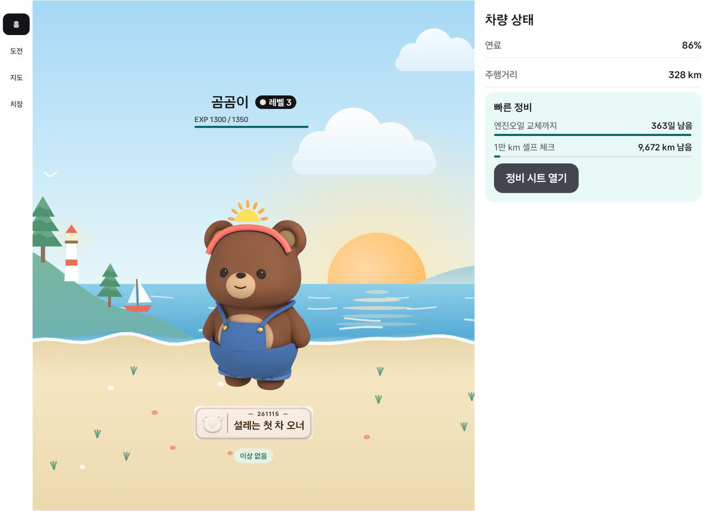
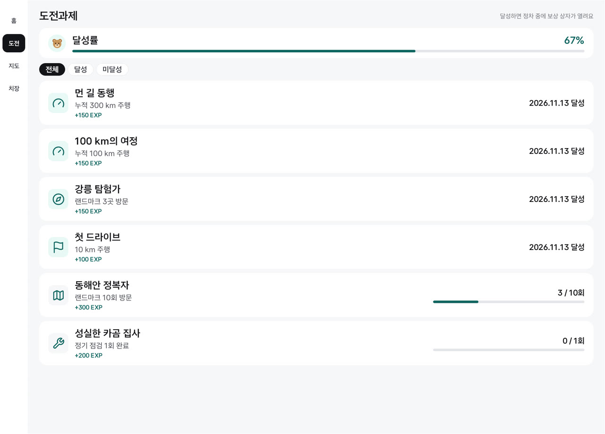
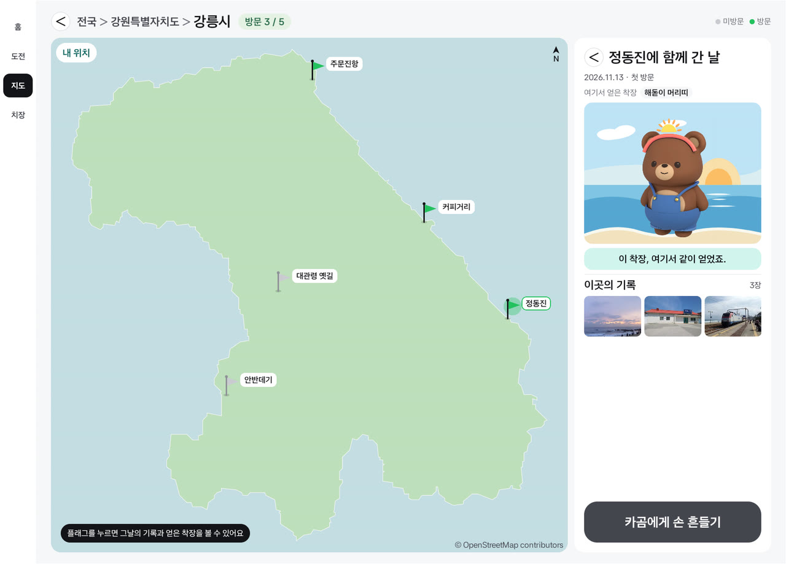
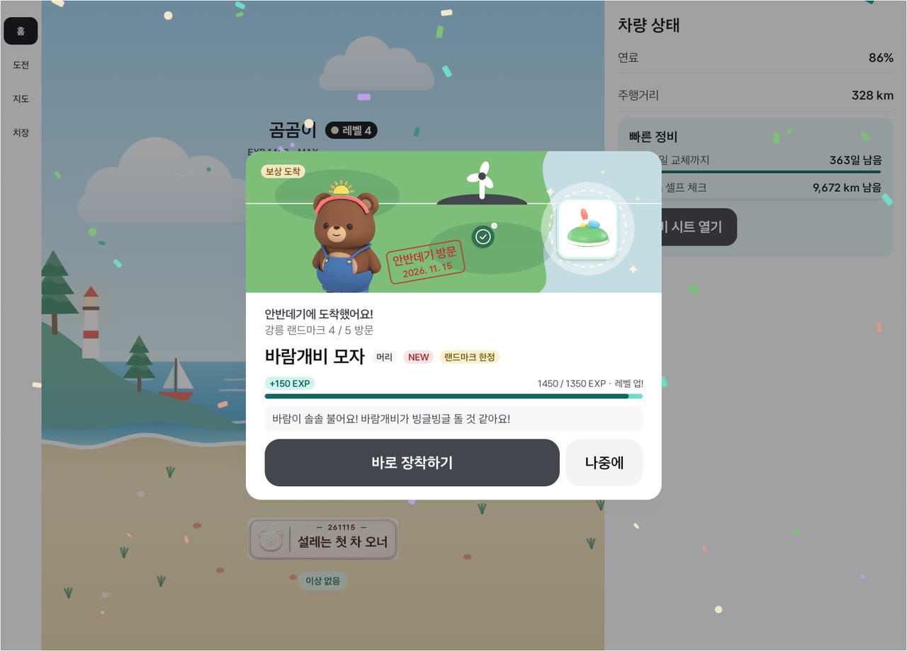
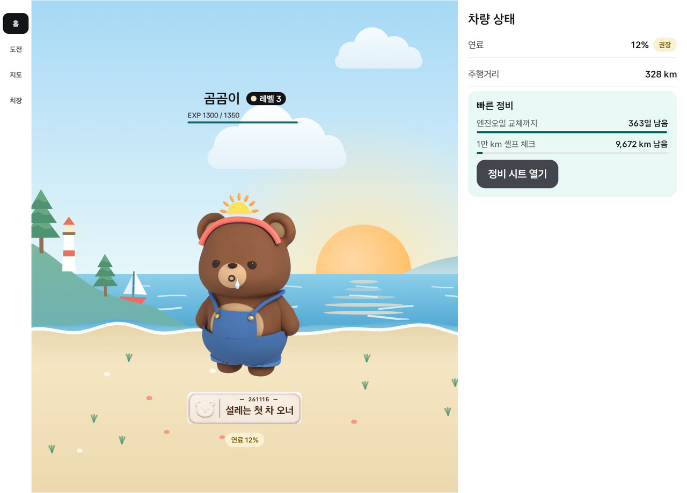
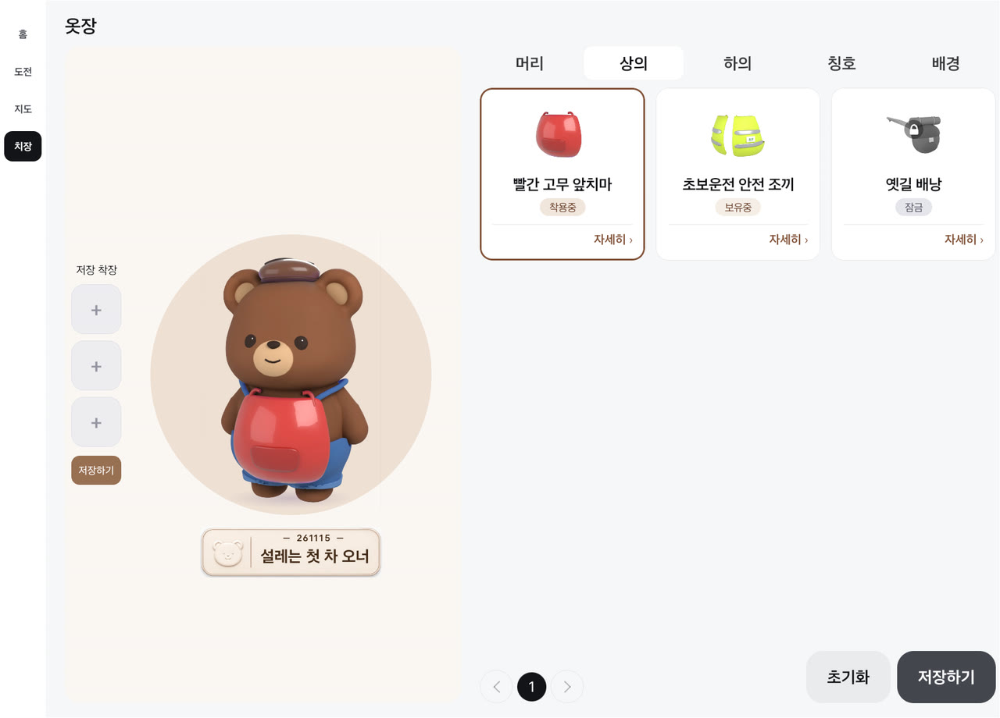
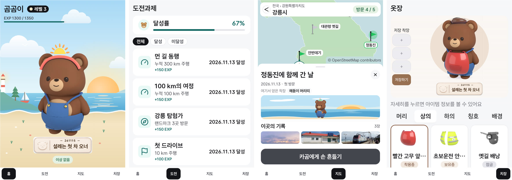

# bearing · 카곰

**첫 10 km부터 출퇴근과 주말 여행까지, 차와 함께한 순간을 캐릭터의 성장과 추억으로 남기는 Pleos Connect 앱.**

운전자는 아무것도 입력하지 않는다. 차량이 알려 주는 주행거리·위치·차량 상태만으로 곰 캐릭터 "카곰"이 자라고, 다녀온 곳의 기념품을 입고, 차를 돌봐야 할 때를 표정으로 알려 준다.



> 앱 이름은 **bearing**, 캐릭터 이름은 **카곰**이다. 코드와 레포, 런처 아이콘에는 `Kagom`/"카곰"으로 적혀 있다.

## 주요 기능

### 1. 달린 만큼 자라는 카곰

성향 질문 3개에 답하면 8가지 색 가운데 내 카곰을 만난다. 그 뒤로는 차량 주행거리가 쌓이면서 도전과제(6개)가 저절로 달성되고, 경험치가 모이면 레벨이 오른다. 첫 10 km를 넘기면 달성 날짜가 새겨진 기념 번호판과 첫 옷을 받는다.



### 2. 다녀온 곳이 남는 지도

차량 위치가 등록된 랜드마크의 반경 400 m 안에 들어오면 방문 날짜가 자동으로 기록된다. 첫 방문에는 그곳의 특색을 담은 옷을 받는다(정동진의 해돋이 머리띠, 안반데기의 바람개비 모자). 지도는 전국 → 시·도 → 시·군 순으로 들어가며, 지금은 강릉 5곳(정동진·커피거리·주문진항·안반데기·대관령 옛길)이 들어 있다.

| 방문 기록과 사진 | 첫 방문 보상 |
|---|---|
|  |  |

### 3. 표정으로 알려 주는 차량 상태

연료·배터리 잔량, 엔진오일·미션오일·브레이크액 레벨, 워셔액 부족에 따라 카곰의 표정과 상태 배지가 바뀐다. 정기 점검 시점에는 주차 후 체크리스트(정비 시트)를 열어 항목을 확인하고 완료를 기록한다.

| 연료가 부족할 때 | 옷장 |
|---|---|
|  |  |

### 4. 옷장과 배경

모은 옷 8종, 칭호 3종, 홈 배경 4종을 입혀 보고 돌려 본다. 배경 "오늘 날씨"는 차량 위치의 실제 날씨를 따라 바뀐다.

### 5. 차를 바꿔도 이어지는 기록

새 차에서 이전 카곰의 기록을 발견하면 "계속 함께하기"로 주행거리·경험치·옷·칭호·방문 기록을 이어받는다. 지금은 시연 명령으로 이 상황을 재현하고, Pleos ID 연동은 후속 계획이다([구현 범위](#구현-범위)).

## 차량에 맞춘 설계

**주행 중에는 방해하지 않는다.** 기어가 P가 아니면 도전과제 달성과 첫 방문을 3초 토스트로만 알린다. 보상 열기, 옷 갈아입히기, 캐릭터 터치 반응, 지도 상세, 점검 기록은 P에 놓은 뒤에 열리고, 팝업은 P가 될 때까지 기다린다. 기어 신호가 없으면 Android Automotive의 `CarUxRestrictionsManager`를 보조로 쓴다.

**화면 두 벌.** 모든 화면을 Pleos Connect의 전체 화면(Full, 가로)과 분할 화면(Split, 세로)에 맞춰 따로 짰다.



**신호가 없어도 죽지 않는다.** 차량이 지원하지 않는 항목은 "확인 불가"로 보이고 나머지는 그대로 동작한다.

**위치는 저장하지 않는다.** 방문 기록에는 장소 ID와 날짜만 남는다. 날씨를 물을 때는 좌표를 소수 첫째 자리(약 10 km)로 줄여 보내고, 위치는 로그에도 남기지 않는다.

## Pleos SDK 사용

| SDK / API | 받는 값 | 쓰는 곳 |
|---|---|---|
| Vehicle 2.3.2 · `FuelPercentListener`, `EvBatteryStateOfChargeListener` | 연료 잔량, 전기차 충전율 | 홈 상태, 카곰 표정 |
| Vehicle · `OilLevelStateListener` | 엔진오일·미션오일·브레이크액 레벨 | 상태 배지, 정비 시트 |
| Vehicle · `LowWasherFluidWaringListener` | 워셔액 부족 | 상태 배지 |
| Vehicle · `DistanceDrivenListener` | 누적 주행거리 | 도전과제, 정비 주기 |
| Vehicle · `GearSelectionListener` | 기어 | 주행 중 제한 |
| FusedLocation 1.1.3 · `getLastKnownLocation`, `registerFusedLocationCallback` | 차량 위치 | 랜드마크 방문 판정, 지도의 내 위치 |
| Android Automotive · `CarUxRestrictionsManager` | 주의 분산 제한 여부 | 기어 신호가 없을 때 주행 판정 |

항목마다 지원 여부를 먼저 확인한 뒤 현재 값을 읽고 변경을 구독한다. 권한은 `CAR_ENERGY`, `CAR_SAFETY`, `CAR_DRIVE`, `FUSED_LOCATION`을 쓴다. SDK 호출은 `data/`에만 있고, 판정 규칙(`core/`)은 SDK를 모른다. 그래서 실제 신호와 시연 입력이 같은 규칙을 거친다.

## 실행

```powershell
git clone https://github.com/hyundai-bearing/kagom.git
cd kagom
$env:JAVA_HOME = "C:\Program Files\Android\Android Studio\jbr"   # java가 PATH에 없을 때
.\gradlew.bat :app:assembleDebug
adb install -r app\build\outputs\apk\debug\app-debug.apk
```

- Android SDK 경로는 Android Studio로 한 번 열면 `local.properties`에 생긴다.
- Pleos SDK는 `nexus-playground.pleos.ai`에서 받는다. 사내망·VPN에서 막히면 첫 빌드가 실패한다.
- Pleos Connect 에뮬레이터(Full)와 세로 폰 에뮬레이터(Split)에서 확인했다.

### 차 없이 시연하기

디버그 빌드에서 레일(Full)·탭바(Split)의 빈 곳을 길게 누르면 시연 패널이 열린다. 같은 동작을 adb로도 넣을 수 있다 (Git Bash 기준, 카곰을 만든 뒤에 쓴다).

```bash
A="adb shell am start --activity-single-top -n com.example.roro/.MainActivity"
adb shell am start -n com.example.roro/.MainActivity --es source mock   # Mock 신호로 시작
$A --ei demo_odo 10020            # 주행거리를 올린다 → 거리 도전과제 달성
$A --es demo_visit LM-GN-01       # 정동진 방문 → 해돋이 머리띠
$A --ei demo_fuel 12              # 연료 12% → 배고픈 카곰
$A --es demo_gear D               # 주행 중 제한 (P로 되돌리면 팝업이 열린다)
$A --ez demo_new_vehicle true     # 새 차에서 이전 카곰 기록 발견
$A --ez demo_reset true           # 처음으로
```

전체 명령은 [`MainActivity.kt`](app/src/main/java/com/example/roro/MainActivity.kt) 머리 주석에 있다.

## 구조

```
Pleos Vehicle · FusedLocation ─┐
시연 패널 · adb (디버그)       ─┴→ data/ 신호 소스 → core/ 규칙 → KagomController(StateFlow) → Compose 화면
                                                              ↘ KagomStore (SharedPreferences, JSON 하나)
```

```
app/src/main/java/com/example/roro/
  core/     규칙과 마스터 데이터: 경험치·레벨, 도전과제, 방문 판정, 차량 상태 심각도 (순수 Kotlin)
  data/     Pleos 차량·위치 신호, 날씨, 저장소
  ui/       theme(토큰) · components · screens · KagomController · KagomApp
app/src/main/assets/
  kagom/    캐릭터·옷 3D 렌더 (tools/closet3d/build_closet.py가 Blender로 만든다)
  regions/  지도 데이터 (tools/regions/*.py가 만든다)
tools/      렌더·지도·측정 도구
docs/       요구사항, 구현 노트, 디자인 자료, 화면 검증 기록
```

- Kotlin + Jetpack Compose, 모듈 하나(`app`), minSdk 28.
- `core/`는 `android.*`를 쓰지 않아 JVM 단위 테스트로 검증한다. 테스트는 60개다.

```powershell
.\gradlew.bat :app:testDebugUnitTest
```

## 구현 범위

| 기능 | 지금 | 다음 |
|---|---|---|
| 카곰 만들기, 도전과제, 레벨, 보상 | 동작 | 도전과제와 보상 추가 |
| 랜드마크 방문 기록 | 강릉 5곳 | 다른 지역으로 확대 |
| 차량 상태 표정·배지, 정비 시트 | 동작 | 차종별 지원 항목 검증 |
| 길 안내 | Android 인텐트로 Google Maps 내비게이션을 연다 | NaviHelper SDK의 `requestRoute`, `addWaypoint`로 Pleos 내비게이션에 목적지·경유지 추가 |
| 차량 교체 후 이어가기 | 시연 명령으로 재현 | Pleos ID 기반 동기화 |
| 음성 | 없음 | TextToSpeech, SpeechToText로 방문 기록 묻고 답하기 |

패키지명은 아직 `com.example.roro`이고, 정식 서명 키가 없으면 release도 디버그 키로 서명된다. 앱마켓에 올리기 전에 둘 다 바꾼다.

## 문서

| 문서 | 내용 |
|---|---|
| [docs/IMPLEMENTATION.md](docs/IMPLEMENTATION.md) | 구현 노트: 구조, 디자인에 없던 값(가정), 지도·렌더 파이프라인, 시연, 검증 |
| [docs/requirements.md](docs/requirements.md) | 요구사항(FR/NFR)과 결정 사항. "현재 데모" 열은 11/5 기준이다 |
| [docs/verification/](docs/verification) | 기능별 Full·Split 화면 검증 기록 |
| [docs/PR_AND_DEPLOY.md](docs/PR_AND_DEPLOY.md) | 브랜치·PR·리뷰·머지·APK 배포 절차 |
| [docs/design/README.md](docs/design/README.md) | 디자인 자료 버전과 받는 법 |
| [docs/FIGMA_BRIDGE.md](docs/FIGMA_BRIDGE.md) | AI 도구가 Figma 파일을 직접 읽게 연결하는 법 |
| [CHANGELOG.md](CHANGELOG.md) | 버전별 변경 내역 |
| [CLAUDE.md](CLAUDE.md) | AI로 코드를 쓸 때의 규칙 (다른 도구는 [AGENTS.md](AGENTS.md)를 거쳐 같은 파일) |

## 개발 규칙

자세한 내용은 [docs/PR_AND_DEPLOY.md](docs/PR_AND_DEPLOY.md) 6·7장.

- `main`에 직접 push하지 않는다. 모든 변경은 PR로, 승인 1명 뒤 merge commit으로 합친다.
- release 빌드는 R8로 줄인다. Pleos SDK의 keep 규칙이 빠지면 모든 신호가 "확인 불가"가 되니, 배포 전에 release APK를 설치해서 확인한다.
- `assets/kagom`, `assets/regions`는 생성 파일이다. 손으로 고치지 않고 스크립트를 고쳐 다시 만든다.

## 라이선스와 출처

외부 라이브러리, 글꼴, 지도 데이터, 날씨 API의 라이선스는 [THIRD_PARTY_NOTICES.md](THIRD_PARTY_NOTICES.md)에 있다. 지도 화면의 "© OpenStreetMap contributors" 표시는 지우지 않는다.

## 이력

이 레포는 시험 레포 `hyundai-bearing/bearing-test`의 `main`(df0333c, PR #1~#11)을 커밋 기록 없이 옮겨 시작했다. 그 전의 커밋·PR·리뷰 기록은 bearing-test에서 본다. bearing-test의 PR 번호는 이 레포의 PR 번호와 다르다.
