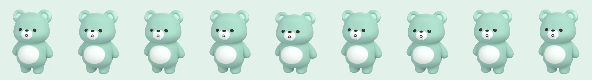
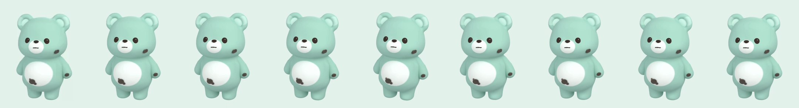
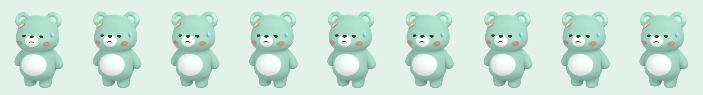
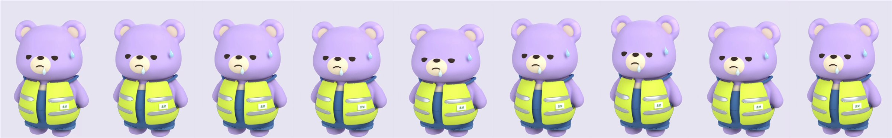
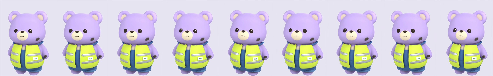

# 이상 상태의 터치 반응 (2026-11-10)

이상 상태(배고픔·아픔·피곤함·얼룩)에서 캐릭터를 누르면 그 표정의 몸짓을 바로 한 번, 가만히 있을 때의 2배 크기로 한다. 표정과 소품은 그대로다.

## 방법

`adb shell screenrecord`로 4초를 녹화하면서 1.6초쯤에 캐릭터를 한 번 누르고, 프레임마다 캐릭터의 머리 꼭대기 높이와 머리 가운데 가로 위치를 쟀다. 아래 그림은 가장 크게 움직인 프레임 둘레를 뽑은 것이다 (맨 왼쪽은 녹화 첫 프레임).

## Pleos Full (녹화 1280×720, 캐릭터 높이 236px)

| 상태 (시연 훅) | 탭 직후 | 탭 전후 |
|---|---|---|
| 배고픔 1 (`demo_fuel 12`) | 머리 꼭대기 +7px(납작) → +5px | ±1px (숨쉬기) |
| 얼룩 (`demo_engine_oil LOW`) | 머리 좌우 +8.9px → −4.3px → +2.7px | ±0.2px |
| 아픔 (`demo_engine_oil CRITICALLY_LOW`) | 머리 좌우 ±1.1px로 0.6초쯤 떪 | ±0.1px |
| 아픔 + 기어 D | 움직임 없음 (전 프레임 0px) | – |

배고픔 1:

얼룩:

아픔 (떨림이 작아 정지 그림으로는 안 보인다. 표정·반창고·식은땀이 그대로인 것만 볼 수 있다):

## 폰 Split (녹화 540×1200, 캐릭터 높이 477px)

| 상태 | 탭 직후 |
|---|---|
| 배고픔 3 (`demo_fuel 3`) | 머리 꼭대기 ±18px (약 3.8%) |
| 얼룩 | 머리 좌우 최대 16px |
| 아픔 | 머리 좌우 최대 2.8px |
| 아픔 + 기어 D | 화면이 전혀 바뀌지 않아 녹화에 프레임이 없다 |
| 대기 | 기존 3D 동작 (손 흔들기) |

배고픔 3:

얼룩:

## 못 한 것

- 피곤함(꾸벅했다 화들짝)은 에뮬레이터에서 보지 못했다. 정기 점검 시기를 넘기려면 `demo_odo`로 주행거리를 바꿔야 하는데, 주행 기록·도전과제가 저장돼서 쓰지 않았다.
- 배고픔 2는 따로 보지 않았다 (1·3과 같은 몸짓, 크기만 다르다).
- 아픔의 떨림은 잰 값이 작다 (Full 녹화 기준 ±1px 남짓). 15~20 fps 녹화라 실제보다 작게 잡혔을 수 있지만, 눈에 덜 띄면 크기를 키워야 한다.
- 실차 확인.
