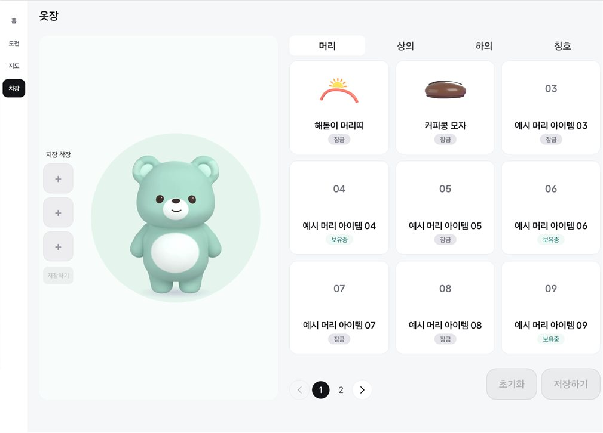
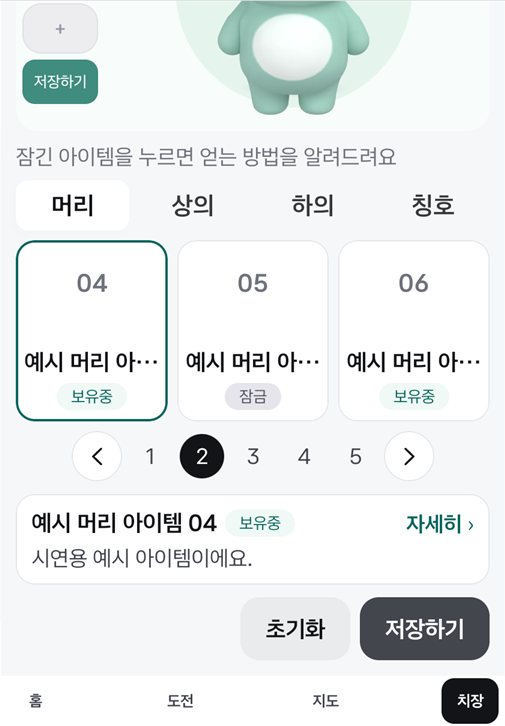

# 치장: 팝업 대신 정보 줄 (2026-11-12 다시 확인)

치장에서 아이템을 누를 때마다 팝업이 화면을 덮어 [닫기]를 한 번 더 눌러야 했던 것을 고친 변경의 확인 기록.
11/12에 옷장 배치·스킨 색 변경(#28, Full 3×3 그리드)과 합치면서 정보 줄의 자리를 옮기고 다시 찍었다.

- 보유 아이템: 누르면 팝업 없이 바로 입혀 본다. 정보 줄에 받은 날·곳.
- 잠긴 아이템: 정보 줄에 얻는 조건·진행과 획득처 버튼.
- 정보 줄의 "자세히 ›"(줄 전체)를 누르면 기존 팝업(Figma 2021:5094 / 2071:7596)이 열린다.
- 정보 줄 자리: Full은 미리보기 아래쪽(곰 발밑), Split은 페이지 넘김 아래.
- Pleos Connect v2.1.0 에뮬레이터, 민트 곰(P02), 예시 데이터 켬, Mock 신호. Full: 앱 창 1682×1210. Split: 세로 슬롯 841×1210. 모두 0.6배로 줄였다.

## Full

| 잠긴 아이템을 누름 | "자세히"를 누름 | 뒤로 키 한 번 (팝업만 닫힘) | 보유 아이템을 누름 | 주행 중 |
|---|---|---|---|---|
|  |  |  |  |  |

## Split (Pleos 세로 슬롯)

| 잠긴 아이템을 누름 | "자세히"를 누름 | 보유 아이템을 누름 | 아래로 밀었을 때 | 주행 중에 카드를 누름 |
|---|---|---|---|---|
|  |  |  |  |  |

## 본 것

- 잠긴 아이템: 정보 줄에 "정동진 방문 시 획득 · 방문 전 · 0 / 1"처럼 조건과 진행이 붙고 [지도에서 보기]가 나온다. 선택 테두리와 "자세히"는 스킨 강조색이다.
- Full: 그리드 세 줄이 다 차 있어도 정보 줄이 카드나 페이지 넘김·버튼을 가리지 않는다.
- Split 슬롯: 잠긴 아이템을 누르면 화면이 정보 줄까지 내려가고 [초기화]·[저장하기]도 보인다. 보유 아이템을 누르면 내려가지 않아 곰이 계속 보이고, 손으로 밀면 정보 줄과 버튼이 나온다.
- 뒤로 키: 팝업이 열려 있으면 팝업만 닫히고, 한 번 더 누르면 정보 줄과 선택 테두리가 지워진다 (Full·Split).
- 주행 중(기어 D): 정보 줄·선택·팝업이 닫히고, 카드를 누르면 "주차 중에 이용할 수 있어요"만 뜬다. 버튼은 꺼진다.

## 알려 둘 것

- 정보 줄은 Figma에 없는 자리다. 디자인 확인이 필요하다.
- Split 슬롯은 Figma Split(1080)보다 낮아(약 920dp) 화면이 한 번에 다 들어가지 않는다. 넘치는 만큼 세로로 밀리게 했다. 이전에는 슬롯에서 [초기화]·[저장하기]가 아예 보이지 않았다.
- 못 본 것: 실차, 폰 세로 에뮬레이터(이번에는 슬롯만 봤다), 민트 외 스킨, 실제 보유 아이템(이 프로필은 보유 아이템이 없어 예시 아이템으로 봤다), [지도에서 보기] 이동(11/11에 본 뒤 다시 누르지 않았다).
