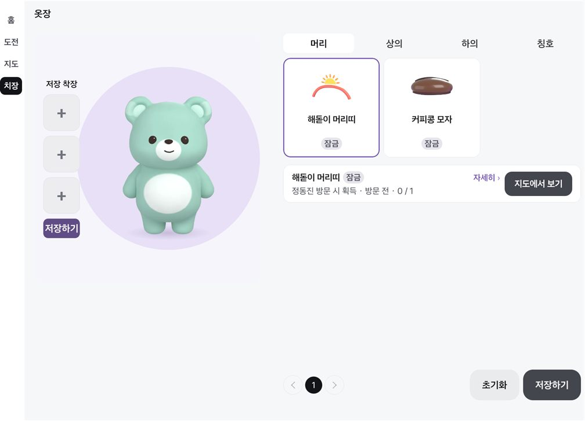
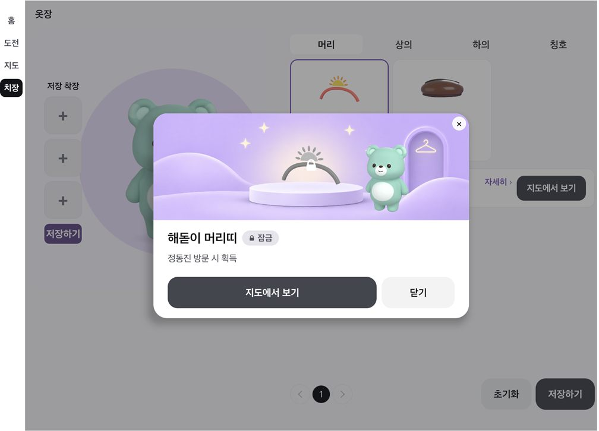
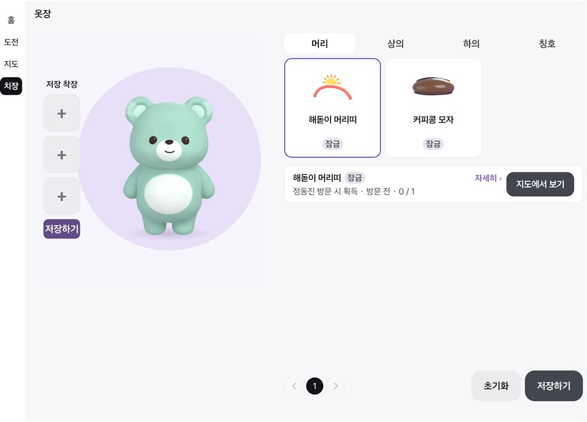
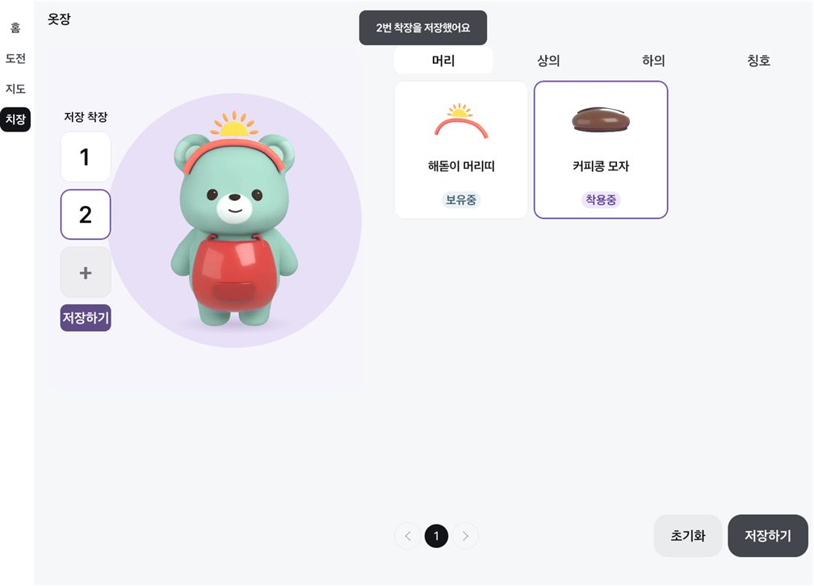
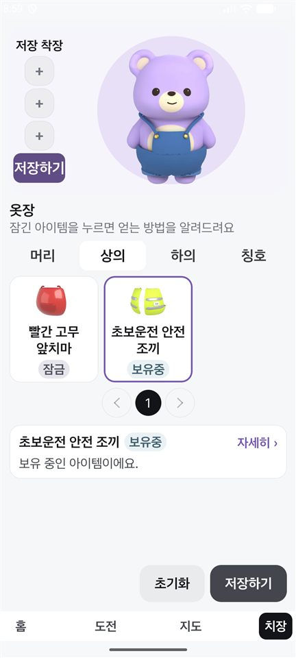
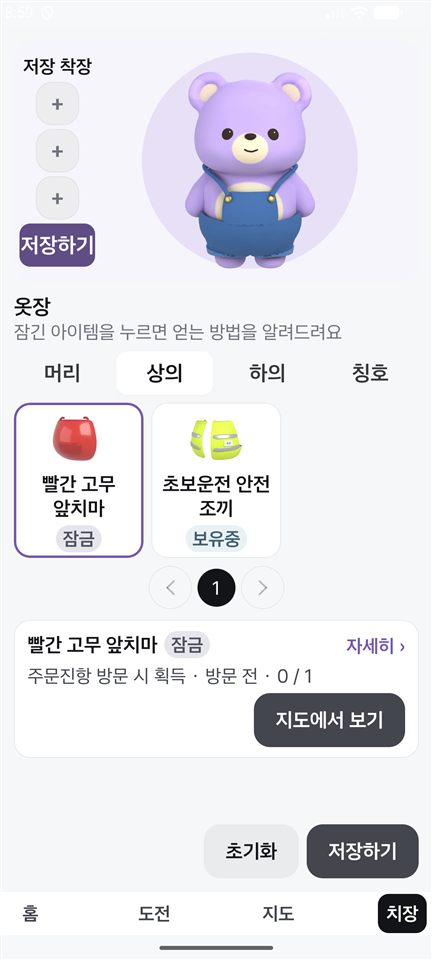
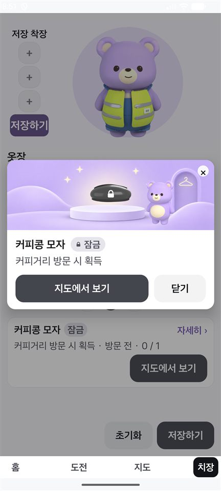
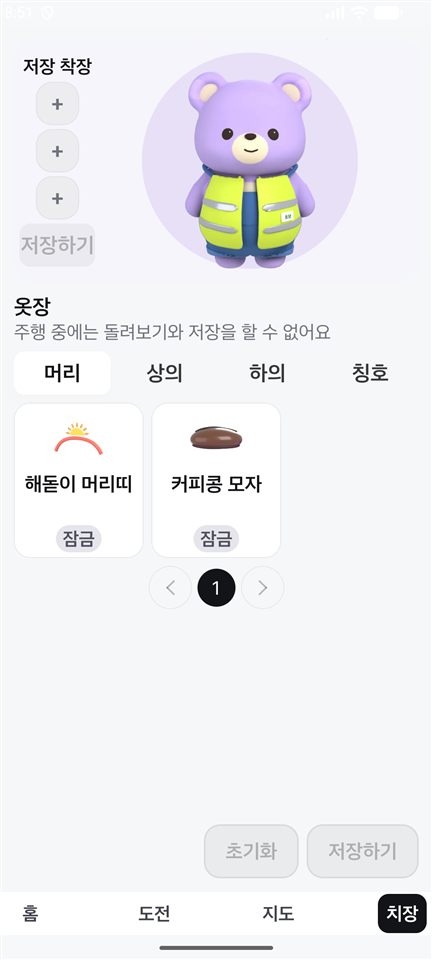

# 치장: 팝업 대신 정보 줄 (2026-11-11)

치장에서 아이템을 누를 때마다 팝업이 화면을 덮어 [닫기]를 한 번 더 눌러야 했던 것을 고친 변경의 확인 기록.

- 보유 아이템: 누르면 팝업 없이 바로 입혀 본다. 정보 줄에 받은 날·곳.
- 잠긴 아이템: 정보 줄에 얻는 조건·진행과 획득처 버튼.
- 정보 줄의 "자세히 ›"(줄 전체)를 누르면 기존 팝업(Figma 2021:5094 / 2071:7596)이 열린다.
- Full: Pleos Connect v2.1.0 에뮬레이터 (앱 창 1682×1210, 0.6배). Split: 폰 에뮬레이터 세로 1080×2400 (0.4배). Mock 신호.

## Full

| 잠긴 아이템을 누름 | "자세히"를 누름 | 뒤로 키 한 번 (팝업만 닫힘) | 보유 아이템을 누름 |
|---|---|---|---|
|  |  |  |  |

## Split

| 보유 아이템을 누름 | 잠긴 아이템을 누름 | "자세히"를 누름 | 주행 중 |
|---|---|---|---|
|  |  |  |  |

## 본 것

- 보유 아이템을 누르면 팝업 없이 곰이 바로 그 옷을 입는다. 착용 중인 아이템을 누르면 벗는다 (전과 같다).
- 잠긴 아이템: 정보 줄에 "정동진 방문 시 획득 · 방문 전 · 0 / 1", 칭호는 "랜드마크 10회 방문 · 3 / 10회"처럼 진행이 붙는다.
- [지도에서 보기]를 누르면 지도 탭의 그 랜드마크로 간다 (Split, 커피콩 모자 → 강릉시 시내 13개 동).
- 뒤로 키: 팝업이 열려 있으면 팝업만 닫히고, 한 번 더 누르면 정보 줄이 닫힌다 (Full·Split).
- 주행 중(기어 D): 정보 줄과 팝업이 닫히고, 아이템을 눌러도 열리지 않는다.

## 알려 둘 것

- 정보 줄은 Figma에 없는 자리다. 디자인 확인이 필요하다.
- Split에서 정보 줄이 버튼 줄 위의 빈 자리를 쓴다. 설명이 두 줄을 넘는 아이템은 없어서 넘칠 때는 보지 못했다.
- 못 본 것: 실차, Pleos Split(841×1210), 예시 데이터의 3페이지 이상.
