# 홈 배경과 배경 보상 (2026-11-12)

홈 캔버스가 단색이어서 배경 그림을 치장 아이템으로 넣었다. 기본 배경 2종(맑은 들판·노을 언덕)과 도전과제 `QST-06` 보상 1종(동해 바다)이다. 설명은 `docs/IMPLEMENTATION.md`의 "홈 배경".

## 확인한 환경

- Pleos Connect v2.1.0 에뮬레이터(`emulator-5554`, 2560×1440, 사용자 10). Full 창 1682×1210, Split 슬롯 841×1210.
- 이미 카곰(민트 P02, 0 km, 보상 없음)이 있는 저장 데이터에 새 빌드를 덮어 설치했다 → 배경 필드가 없던 기존 저장 데이터가 그대로 열리는지도 같이 봤다.
- 확인 전 저장 데이터를 떠 두었다가 끝난 뒤 되돌렸다.

```
adb -s emulator-5554 install -r app/build/outputs/apk/debug/app-debug.apk
adb -s emulator-5554 shell am start --user 10 --activity-single-top -n com.example.roro/.MainActivity --es demo_gear P
adb -s emulator-5554 shell am start --user 10 --activity-single-top -n com.example.roro/.MainActivity --ei demo_odo 300   # QST-01·02·06 달성
adb -s emulator-5554 shell am start --user 10 --activity-single-top -n com.example.roro/.MainActivity --es demo_gear D
adb -s emulator-5554 shell input swipe 2547 720 1700 720 600   # Split 슬롯으로
```

## Full (가로)

| 화면 | 본 것 |
|---|---|
| 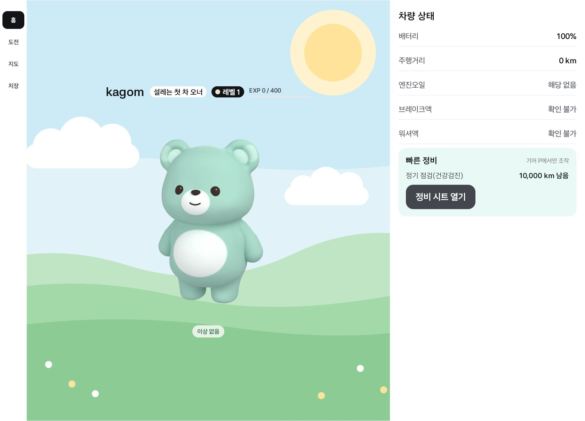 | 기존 저장 데이터로 처음 열면 기본 배경 "맑은 들판"이 깔린다. 헤더 글자 뒤에는 구름·해가 없다 |
| 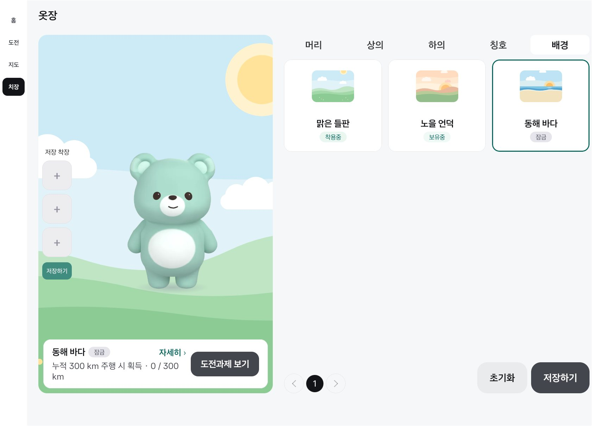 | 옷장 "배경" 탭 (탭 5개). 미리보기에 장착한 배경이 깔리고, 잠긴 "동해 바다"를 누르면 정보 줄에 조건·진행(0 / 300 km)과 [도전과제 보기]가 나온다 |
| 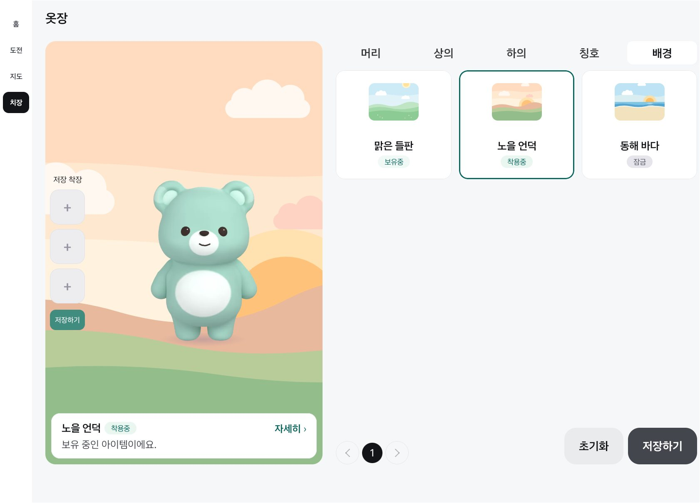 | 보유한 "노을 언덕"을 누르면 바로 미리보기에 깔린다 |
| 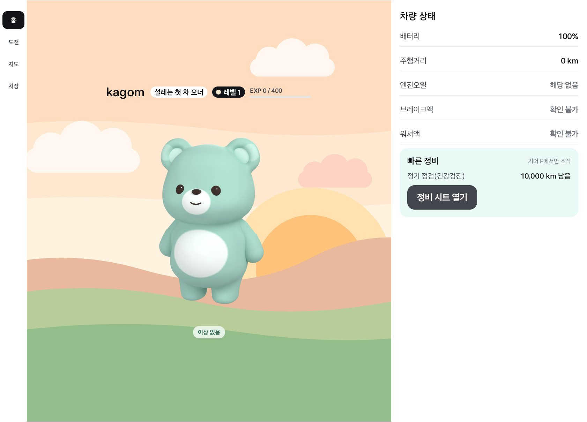 | [저장하기] 뒤 홈 |
| 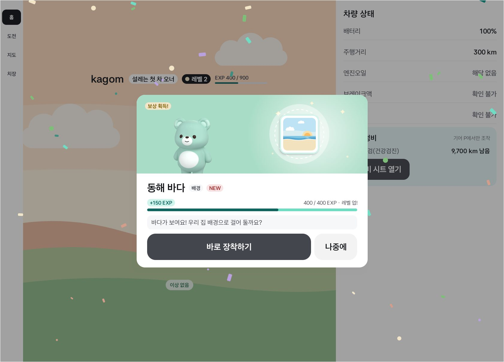 | 300 km → `QST-06` 보상 상자를 열면 배경 그림이 쇼케이스에 나온다. 종류 칩 "배경" |
| 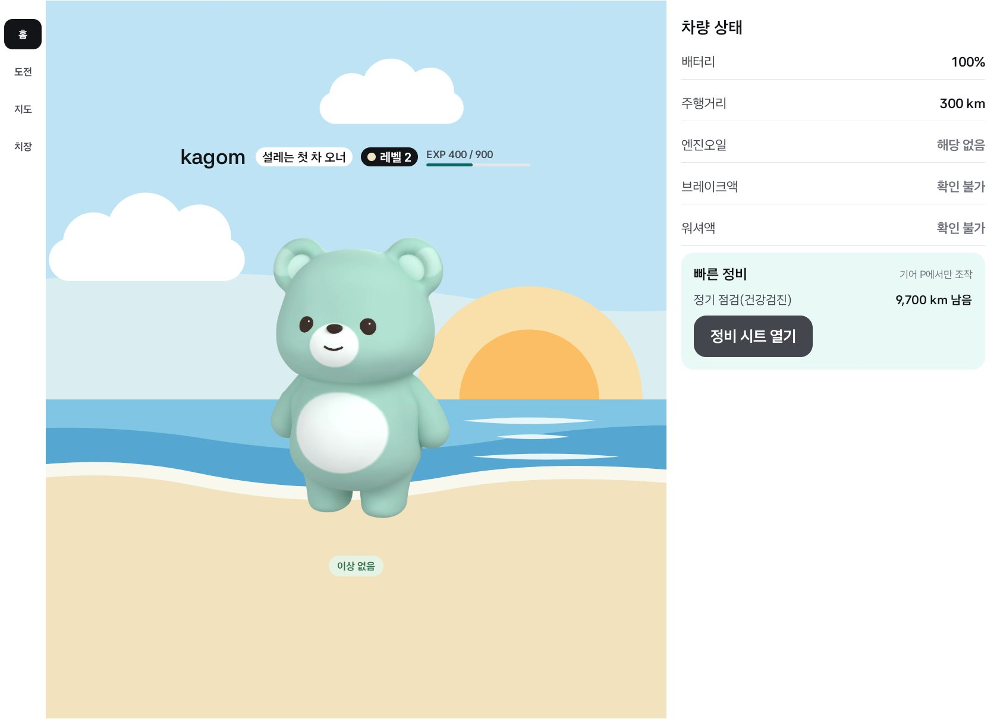 | [바로 장착하기] 뒤 홈. 곰이 모래밭에 선다 |
| 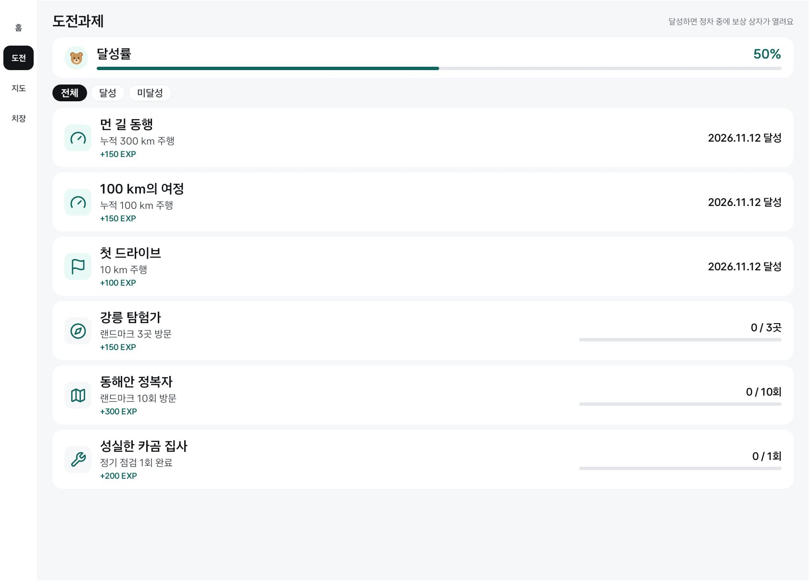 | 도전과제 목록에 "먼 길 동행"이 더해져 6개. 달성률 3/6 = 50% |
| 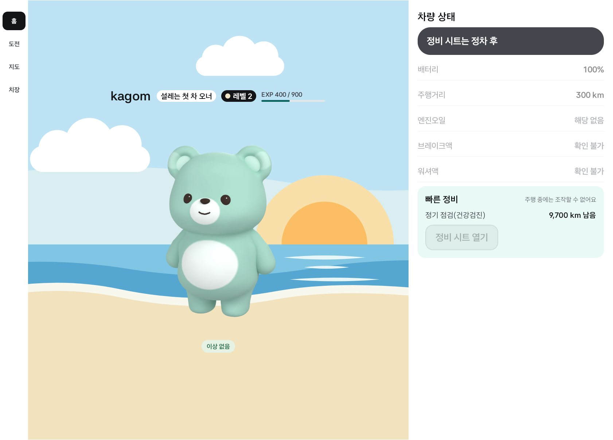 | 기어 D: 배경은 그대로 보인다 |
| 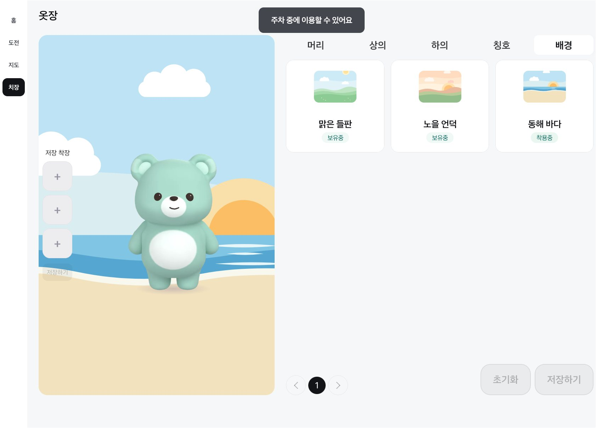 | 기어 D에서 다른 배경을 눌러도 바뀌지 않고 "주차 중에 이용할 수 있어요"만 뜬다. [초기화]·[저장하기] 꺼짐 |

## Split (세로 슬롯)

| 화면 | 본 것 |
|---|---|
| 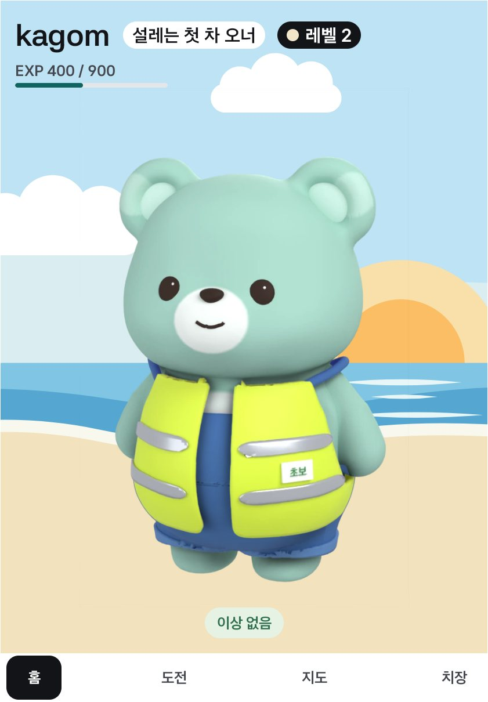 | 화면 전체에 깔린다. 좌우가 잘려도 해·구름이 남고 곰 발이 모래밭에 닿는다 |
| 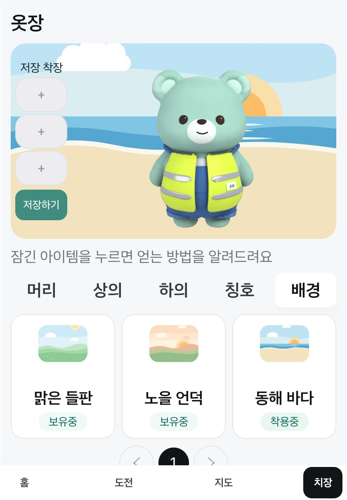 | "배경" 탭까지 탭 5개가 한 줄에 들어간다. 세 장이 한 페이지 |
| 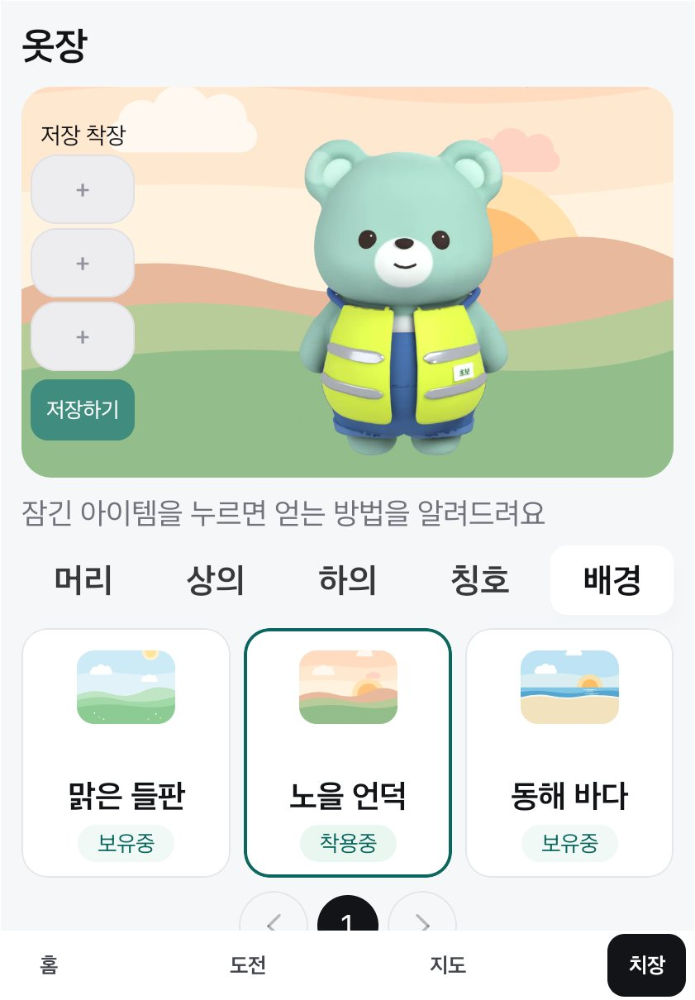 | "노을 언덕"을 누르면 미리보기에 깔린다 |
| 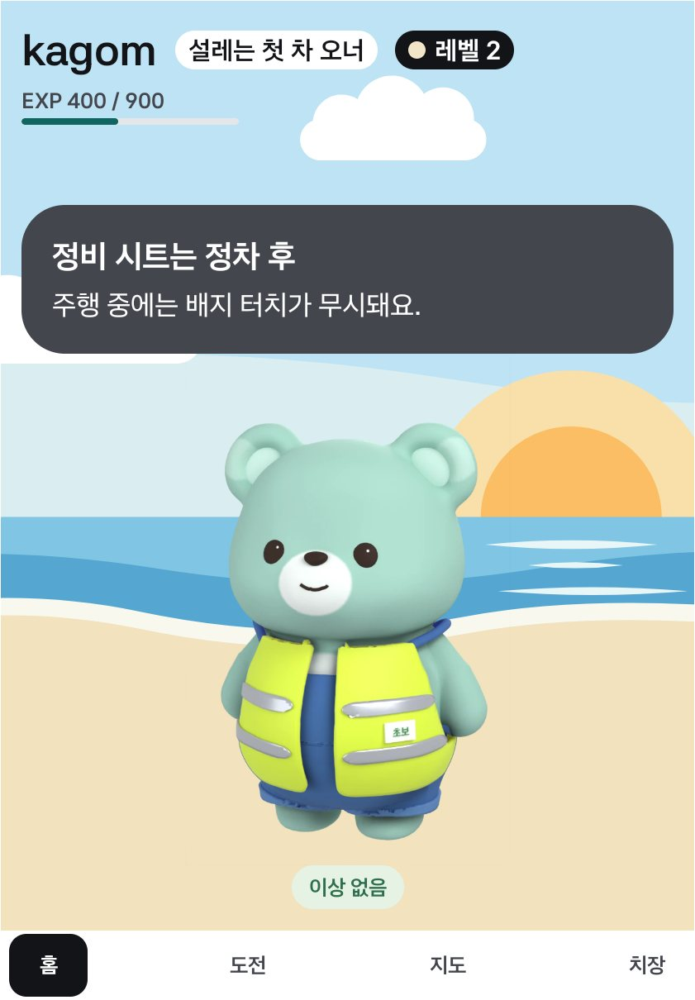 | 기어 D: 배경은 그대로, 안내 배너가 그 위에 뜬다 |

Split 캡처의 곰은 확인 도중 받은 조끼·멜빵을 입고 있다 (배경과는 상관없다).

## 못 본 것

- Figma: 브리지가 연결돼 있지 않아 홈 배경 시안이 있는지 Figma에서 직접 확인하지 못했다. 가이드 v1.2 PDF에서는 찾지 못했다.
- 폰 세로 에뮬레이터(이번에는 Pleos 슬롯만), 실차, 민트(P02) 외 스킨.
- 저장 착장에 배경이 같이 저장·적용되는 동작은 코드와 단위 테스트(`Equipped`)로만 확인했고 화면에서 눌러 보지는 않았다.
- Split에서 잠긴 배경의 정보 줄·팝업 (Full에서만 봤다. 다른 아이템과 같은 코드다).

## 보다가 알게 된 것 (이 변경과 무관)

- 옷(조끼·멜빵)을 입으면 캐릭터 칸 가장자리에 2px짜리 아주 옅은 선(색 차이 2/255)이 보인다. 아이템 레이어 가장자리의 알파로 보이고, 단색 배경에서도 같은 값이었을 것이다. 고치지 않았다.
