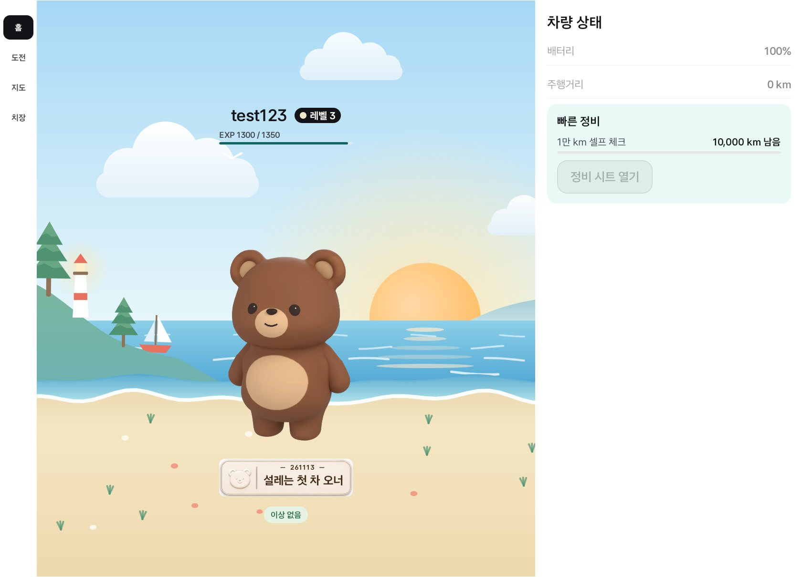
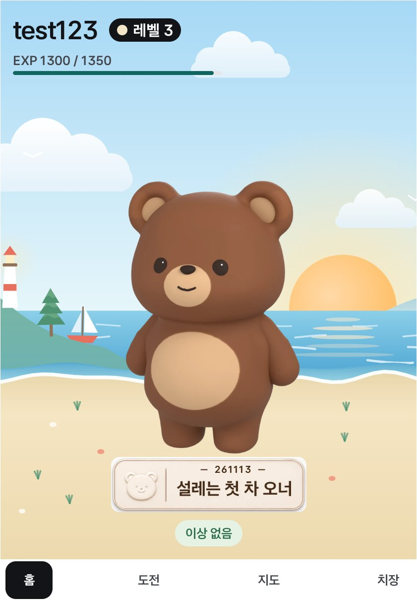

# 홈 캐릭터를 모래사장 위로 (2026-11-13)

바닷가 배경(BG-03)에서 곰 발이 물가에 걸려 있었다. Full에서 캐릭터·번호판·배지 묶음을 120 내려 모래사장 위에 서게 했다. 머리(이름·레벨·EXP)는 그대로다.

## 방법

Pleos Connect 에뮬레이터(2560×1440, 사용자 10)에서 `demo_background BG-03`(저장 안 함)으로 바닷가 배경을 깔고 앱 창만 잘랐다. 보상 팝업이 큐에 있어 기어 D(`demo_gear D`)에서 찍었다(팝업은 P가 될 때까지 기다리고, 정비 시트 버튼이 흐리게 보인다). 앱 데이터는 바꾸지 않았다.

## Pleos Full (1682×1210)

곰 발이 물가보다 아래 모래 위에 있다. 번호판과 "이상 없음" 배지도 같이 내려왔고 화면 안에 들어온다.

## Pleos 세로 슬롯 Split (841×1210)

바꾸지 않았다. 이미 곰 발이 모래사장 위다.

