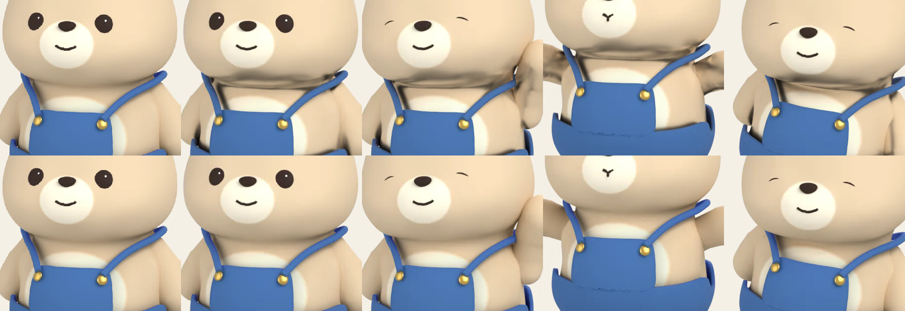
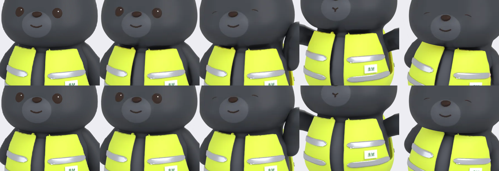
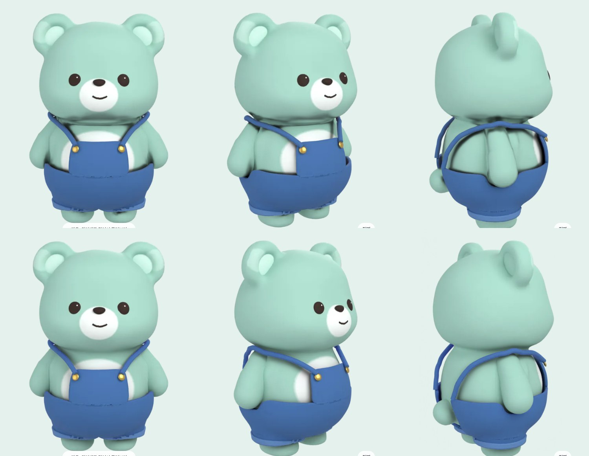
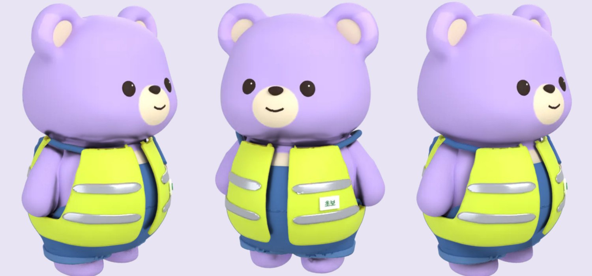

# 옷 레이어의 목 그림자 (2026-11-10)

데님 멜빵 반바지를 입고 움직이거나 돌리면 목 부분이 일그러져 보이던 문제.

## 원인

아이템 레이어에는 옷이 몸에 드리우는 그림자가 같이 들어간다 (곰 = 그림자만 받는 투명 처리). 정지 화면용 `item_*.webp`는 무광 스킨 P03으로 찍었는데, 돌려보기(`turn/i_*`)와 터치 반응(`motion/*/i_*`) 레이어는 몸 렌더를 다 돈 뒤 마지막 스킨(P08 로즈골드, 금속성 0.85) 그대로 찍었다. 금속 몸은 턱 밑 주름에 반사 무늬 같은 진한 그림자를 만들고, 이 레이어가 모든 스킨 위에 겹쳐졌다.

같은 프레임(돌려보기 0단 2번, 멜빵)을 그림자받이 스킨과 샘플 수만 바꿔 렌더해서 확인했다. 숫자는 턱 밑~어깨 영역의 그림자 알파다.

| 조건 | 평균 | 최대 |
|---|---|---|
| P03, 40샘플 | 0.119 | 0.61 |
| P03, 96샘플 | 0.120 | 0.62 |
| P08, 40샘플 | 0.242 | 1.00 |
| P08, 96샘플 | 0.244 | 1.00 |

샘플 수는 영향이 없고 스킨만 영향을 준다.

## 고친 뒤

`build_closet.py`가 아이템 레이어를 찍을 때 늘 `LAYER_SKIN`(P03)으로 맞춘다. `turn/i_*` 864장과 `motion/*/i_*` 528장을 다시 렌더했다. 몸 프레임과 정지 레이어는 그대로다.

| 아이템 | 프레임 | 고치기 전 평균/최대 | 고친 뒤 평균/최대 |
|---|---|---|---|
| 멜빵 | 정지 `item_` | 0.120 / 0.62 | 0.120 / 0.62 |
| 멜빵 | 돌려보기 0단 2번 | 0.240 / 1.00 | 0.118 / 0.61 |
| 멜빵 | 손 흔들기 0번 | 0.241 / 1.00 | 0.118 / 0.62 |
| 멜빵 | 손 흔들기 14번 | 0.230 / 1.00 | 0.117 / 0.67 |
| 멜빵 | 발 동동 10번 | 0.255 / 1.00 | 0.118 / 0.69 |
| 멜빵 | 돌려보기 0단 48장 평균 | 0.252 | 0.146 |
| 멜빵 | 동작 88장 평균 | 0.232 | 0.116 |
| 안전 조끼 | 돌려보기 0단 2번 | 0.333 / 0.86 | 0.147 / 0.60 |
| 안전 조끼 | 동작 88장 평균 | 0.284 | 0.139 |
| 앞치마 | 돌려보기 0단 2번 | 0.265 / 0.95 | 0.145 / 0.85 |
| 보드숏 | 돌려보기 0단 2번 | 0.101 / 0.28 | 0.027 / 0.09 |

돌려보기 0단 2번과 동작 0번은 정지 화면과 같은 시점이라, 고친 뒤에는 정지 레이어와 값이 같다 (정지 화면에서 돌리거나 누르는 순간 목이 바뀌지 않는다). 머리 아이템은 이 영역에 그림자가 없다.

아래는 에셋을 앱과 같은 순서로 겹친 그림이다 (에뮬레이터 캡처가 아니다). 윗줄이 고치기 전, 아랫줄이 고친 뒤. 왼쪽부터 정지 화면, 돌려보기 0단 2번, 손 흔들기 14번, 만세 10번, 발 동동 10번.

P01 + 데님 멜빵 반바지:



P04 + 초보운전 안전 조끼:



## 에뮬레이터

Pleos Full, 치장에서 데님 멜빵 반바지 시착(저장하지 않음) 후 돌려보기. 윗줄이 고치기 전(main `2294a84`), 아랫줄이 고친 뒤. 정면 / 조금 돌림 / 뒤쪽. 고치기 전에는 목과 끈 둘레, 등 쪽에 진한 줄무늬가 있다.



폰 Split, 홈에서 멜빵 + 안전 조끼를 입은 캐릭터를 밀어 돌림. 왼쪽 두 장이 고치기 전, 오른쪽이 고친 뒤.



터치 반응 동작도 폰에서 재생해 목이 정지 화면과 같게 보이는 것을 확인했다. 못 한 것: 실차 확인, 스킨 8종 전부(에뮬레이터에서는 P02·P03만 봤고 나머지는 위 합성 그림과 측정으로 대신했다).

## 다시 만드는 명령

```
rm app/src/main/assets/kagom/turn/i_*.webp app/src/main/assets/kagom/motion/*/i_*.webp
blender -b --factory-startup -P tools/closet3d/build_closet.py -- --glb <절대경로>/tools/closet3d/source/pebble_bear.glb --skins <절대경로>/tools/closet3d/source/skins --font <절대경로>/app/src/main/res/font/asta_sans.ttf --out <절대경로>/app/src/main/assets/kagom --what turn --skip-existing
blender -b --factory-startup -P tools/closet3d/build_closet.py -- (같은 인자) --what motion --skip-existing
```

Blender 5.2.3, RTX 4050 (OptiX). `assets/kagom` 56.6 MB → 59.5 MB (아이템 레이어 33.8 MB → 36.7 MB).
