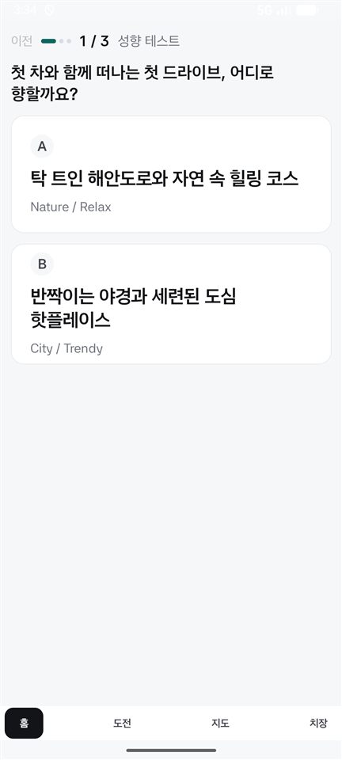
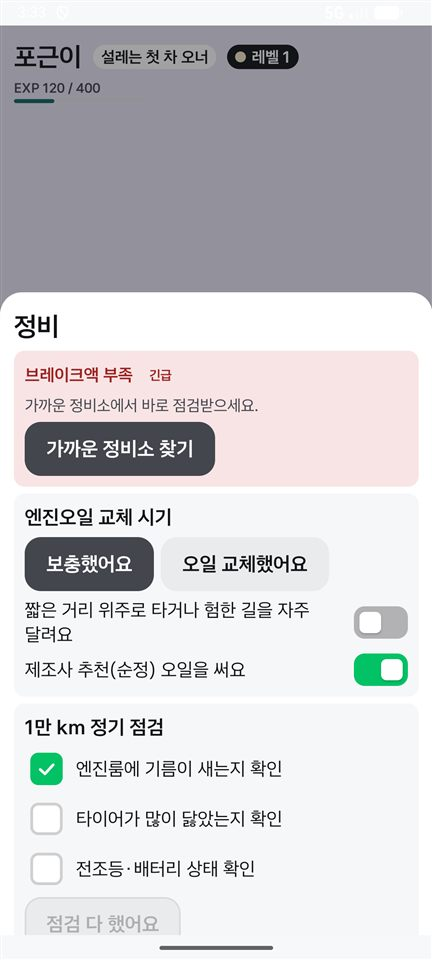
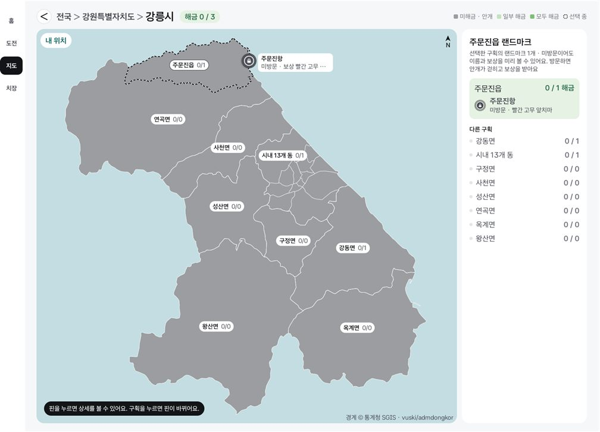
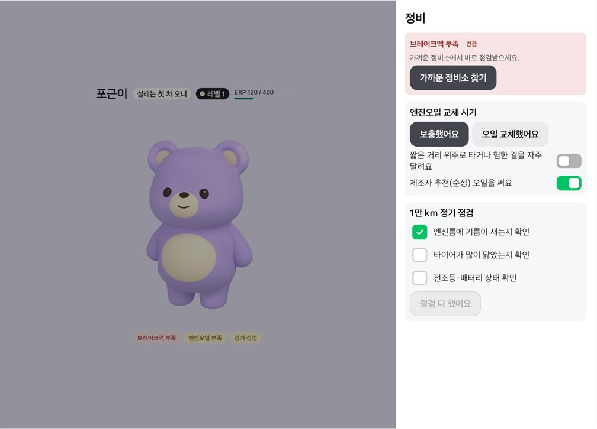

# 줄바꿈을 어절 단위로 (2026-11-11)

이슈 #18 2번(한 글자만 다음 줄로 넘어가는 줄바꿈)을 고친 변경의 확인 기록. `Type.kt`의 공통 `style()`에 넣어 모든 글자에 적용된다.

- Full: Pleos Connect v2.1.0 에뮬레이터 (API 34, 시스템 언어 한국어), 앱 창 1682×1210 (`full-*.jpg`, 0.6배).
- Split: 폰 에뮬레이터 세로 1080×2400 (API 37, 시스템 언어 영어) (`split-*.jpg`, 0.4배).

| 화면 | 전 | 후 |
|---|---|---|
| SCR-01 질문·선택지 B (Split) | "…어디로 향할까 / 요?", "…도심 핫플레이 / 스" |  |
| POP-05 토글 (Split) | "…험한 길을 자주 달려 / 요" |  |
| 지도 패널 안내 (Full) | "…방문하면 안 / 개가 걷히고" |  |

그 밖:  

## 본 것

- Full·Split: 홈, 도전과제, 치장(예시 데이터, 주행 중), 지도(전국·강원·강릉), POP-02 언박싱·공개, POP-03, POP-04, POP-05(내연·EV·점검 완료), SCR-00 Carry-over, SCR-01, SCR-02. 한 글자만 떨어지는 줄이 없고, 이 변경으로 글자가 잘리거나 칸을 넘치게 된 곳도 없다. Full 지도의 핀 이름표가 "보상 빨간 고무 …"로 잘려 보이는 것은 전부터 있던 문제이고 #21에서 고친다 (이 브랜치는 `main` 기준).
- 로캘 고정이 필요한지: `localeList`를 빼고 빌드하면 Pleos 에뮬레이터(시스템 언어 한국어)는 그대로 어절 단위인데, 폰 에뮬레이터(영어)는 다시 "달려 / 요"로 끊겼다.

## 알려 둘 것

- Android 13(API 33) 미만에서는 어절 단위 줄바꿈이 적용되지 않고 전처럼 보인다. `minSdk`는 28이지만 그런 기기에서는 확인하지 못했다.
- 못 본 것: 실차, Pleos Split(841×1210), 시연 패널.
