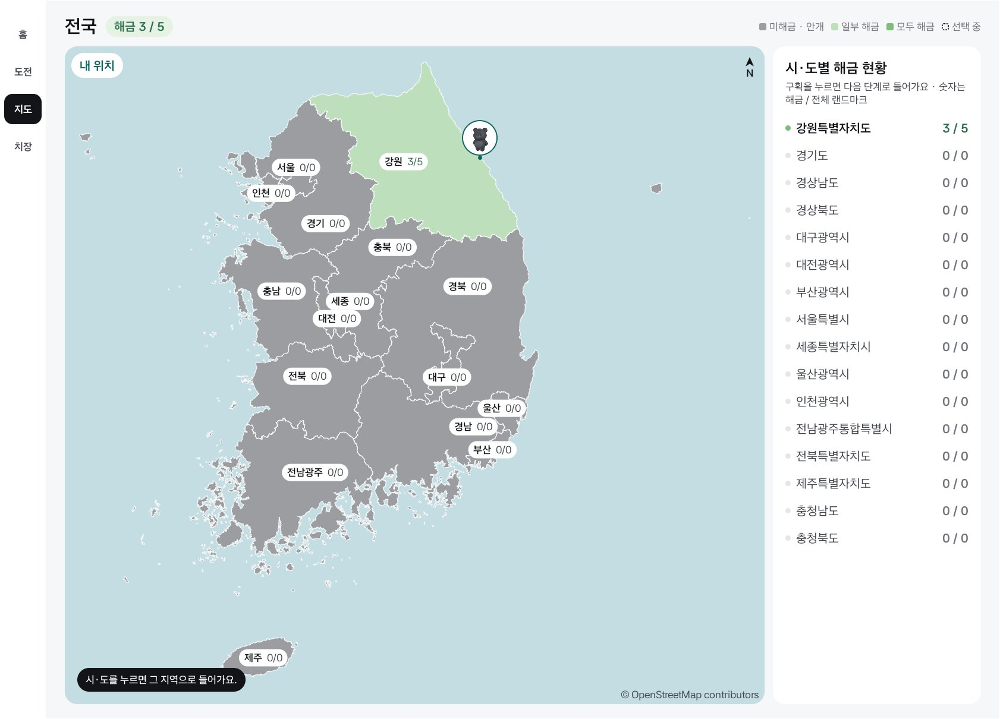
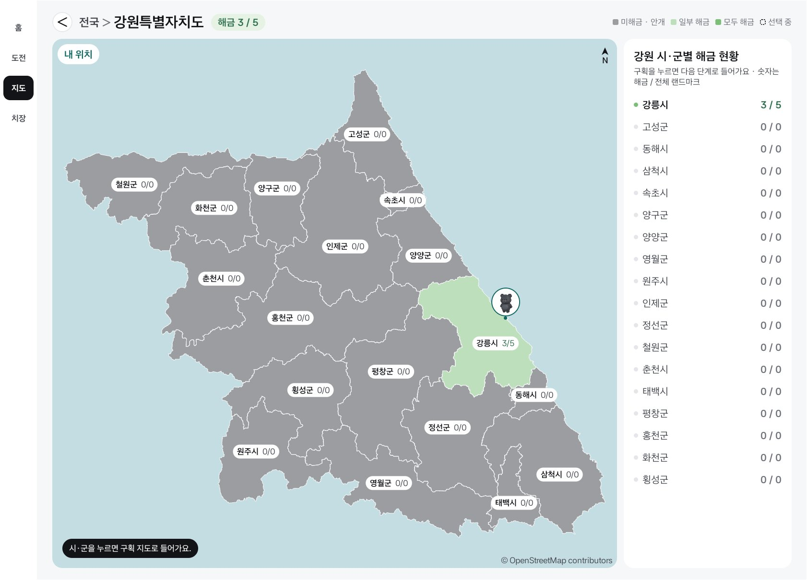
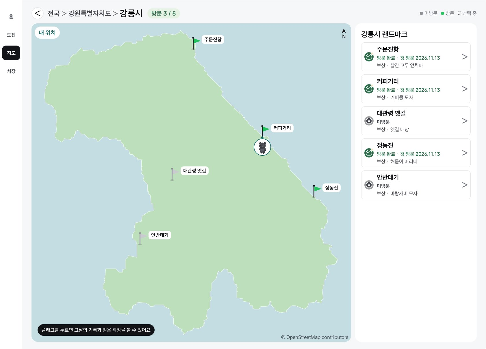
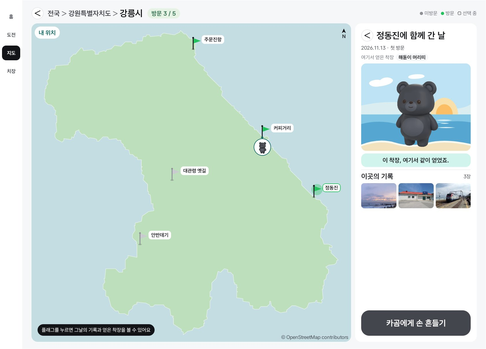
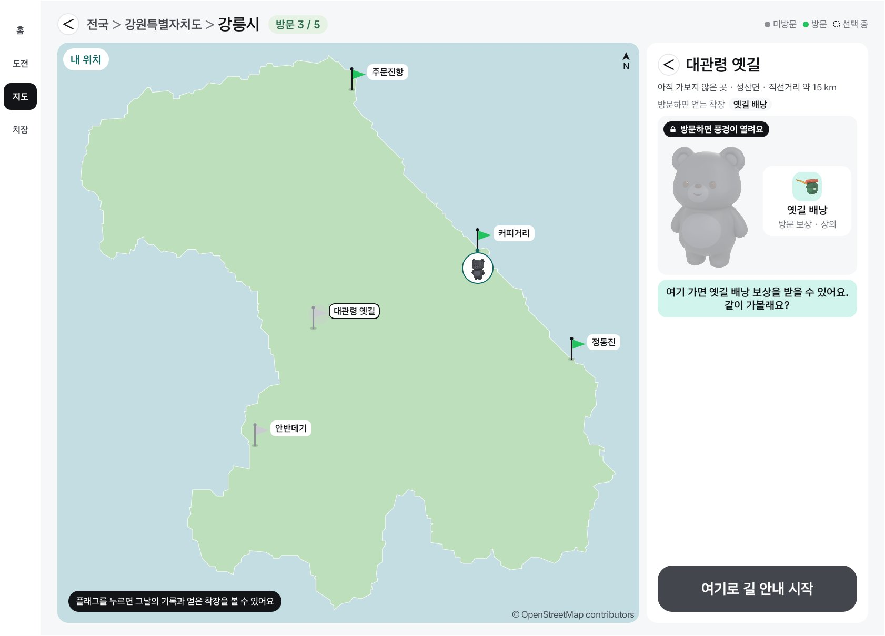
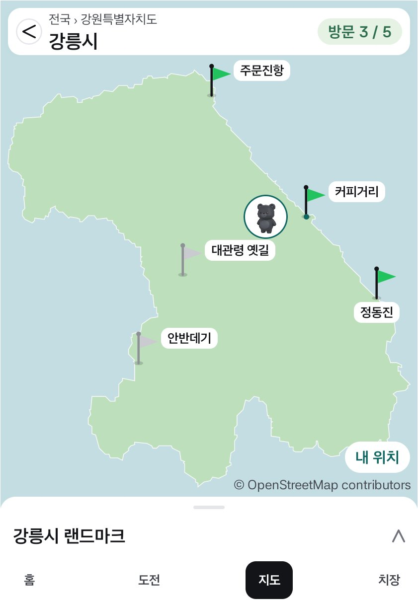
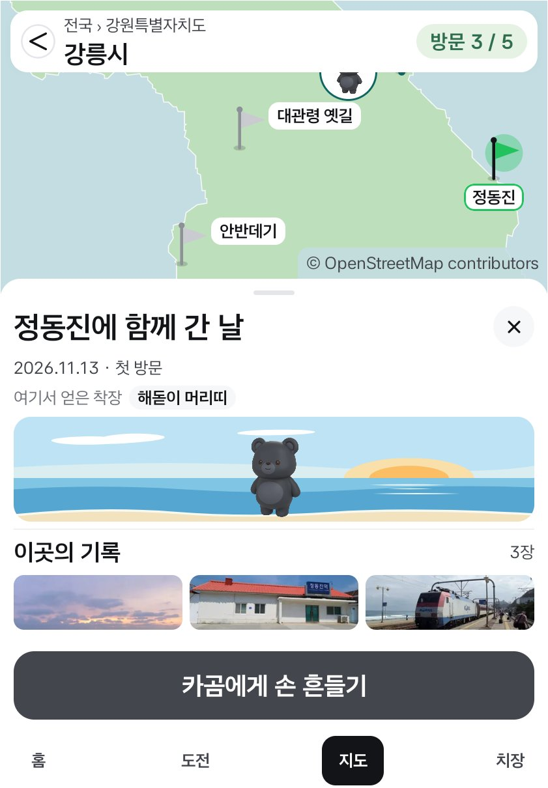
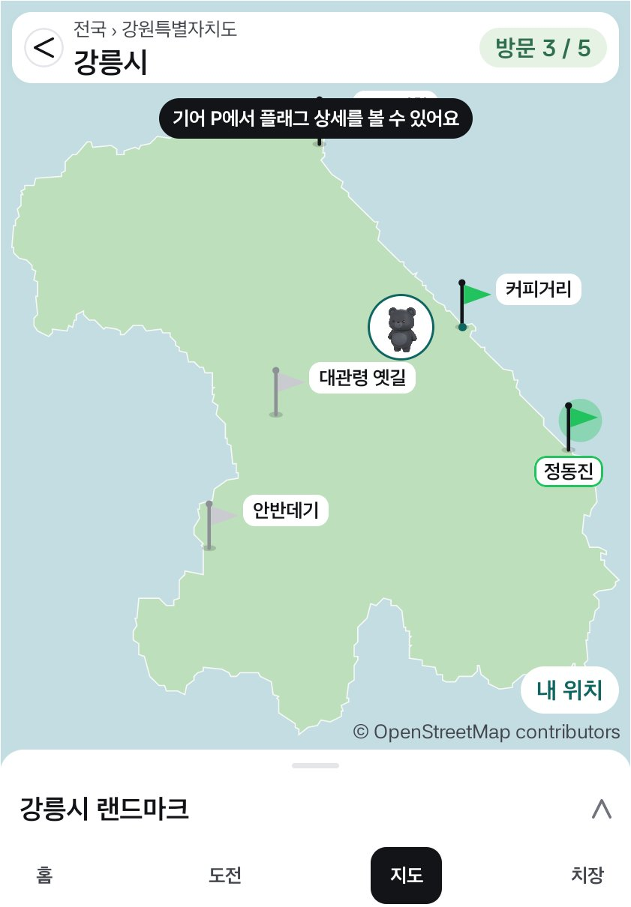

# 지도: 지역 전체 색칠과 시·군 플래그 (2026-11-13)

지도 색을 모든 단계(전국·시·도·시·군)에서 지역 한 덩어리의 방문 비율로 칠한다. 시·군 지도는 Figma SCR-05 layer=3(149:4593)처럼 읍·면 경계 없이 그리고, 랜드마크를 플래그로 띄운다.

## 방법

Pleos Connect 에뮬레이터(2560×1440, 사용자 10)에서 앱 창만 잘랐다. 테스트용으로 강릉 랜드마크 다섯 곳 중 셋(주문진항, 커피거리, 정동진)을 방문한 상태를 만들었다(`demo_visit`, 보상 팝업은 미룸). 확인이 끝난 뒤 앱 데이터는 테스트 전 백업으로 되돌렸다.

비교한 Figma 화면: L1 전국 149:4177, L2 시·도 149:4378, L3 강릉 149:4593(Full)·151:4546(Split), L3 미방문 선택 351:4417.

## Pleos Full (1682×1210)

전국: 강원이 일부 방문이라 연두색 한 덩어리다. 다른 시·도는 회색이다.

강원: 강릉시 전체가 연두색이다(예전에는 방문한 읍·면만 칠했다).

강릉: 읍·면 경계 없이 시 한 덩어리, 방문 완료 플래그는 초록, 미방문은 회색이다. 머리 칩은 "방문 3 / 5"이고, 범례는 플래그 두 가지다. 출처는 "© OpenStreetMap contributors"만 남았다.

방문한 플래그(정동진) 선택: 플래그 둘레에 원, 이름표 테두리가 초록이다. 오른쪽에 상세가 열린다.

미방문 플래그 선택: 이름표 테두리가 검정이고, 상세에 잠긴 풍경과 길 안내 버튼이 있다(Figma 351:4417).

## Pleos 세로 슬롯 Split (841×1210)

강릉([내 위치]로 바로 들어감): Full과 같은 색·플래그, 머리 칩 "방문 3 / 5".

정동진 플래그 선택: 시트가 상세 높이로 올라오고 지도가 고른 플래그를 시트 위 가운데로 민다.

주행 중(`demo_gear D`): 상세가 닫히고 시트가 접히며, "기어 P에서 플래그 상세를 볼 수 있어요"를 띄운다.

## 못 한 것

- Split의 전국·시·도 단계는 Full과 같은 그리기 코드(`SceneLayer`)라 따로 캡처하지 않았다.
- 해금 중(보상 대기) 플래그 깜빡임은 정지 그림이라 남기지 않았다.
