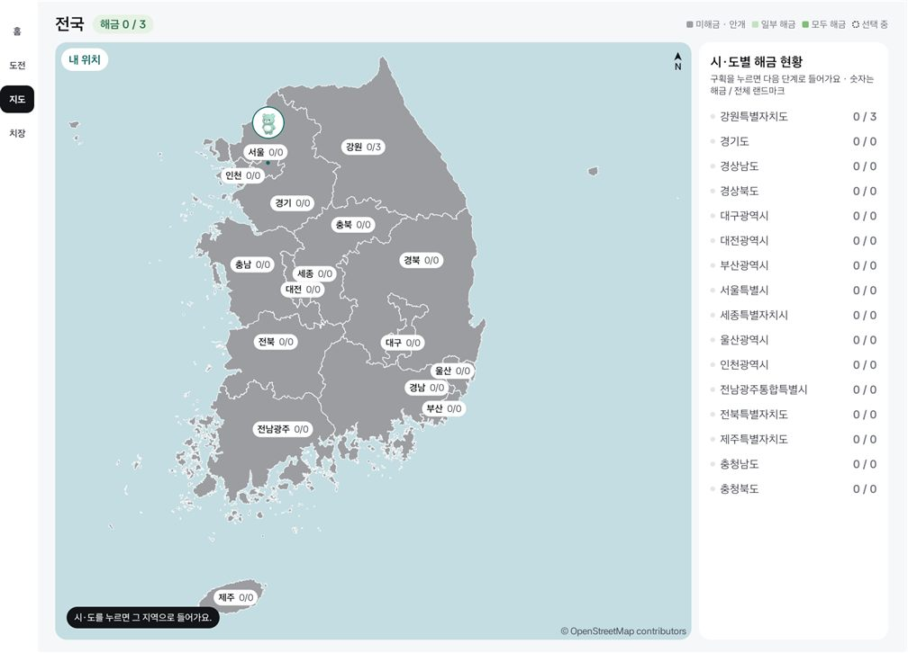
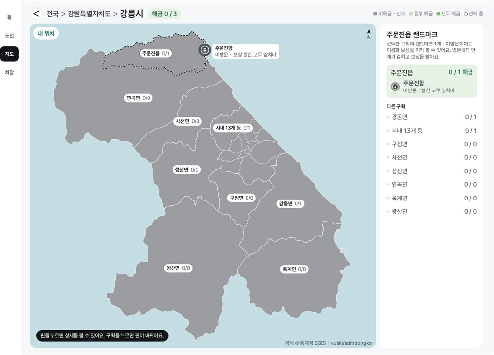
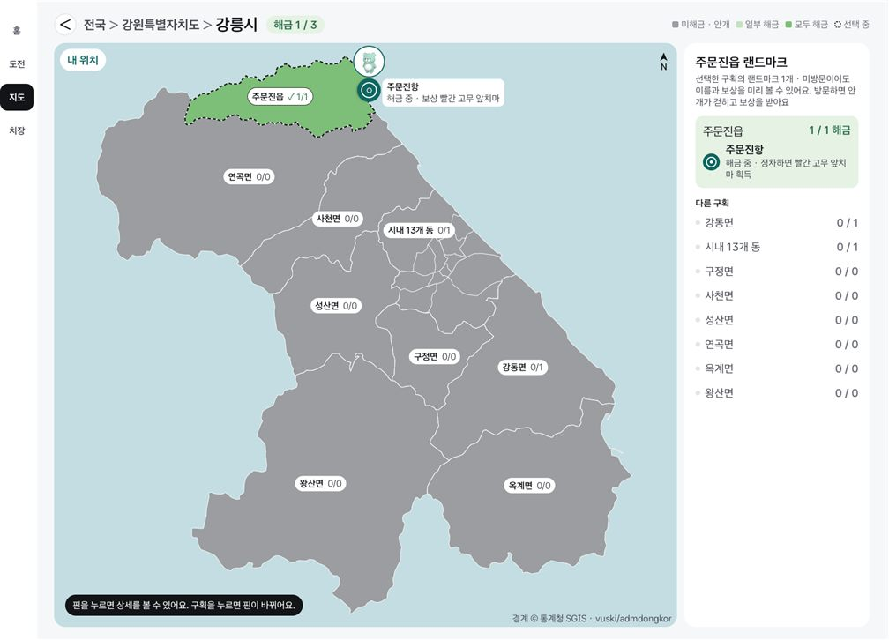
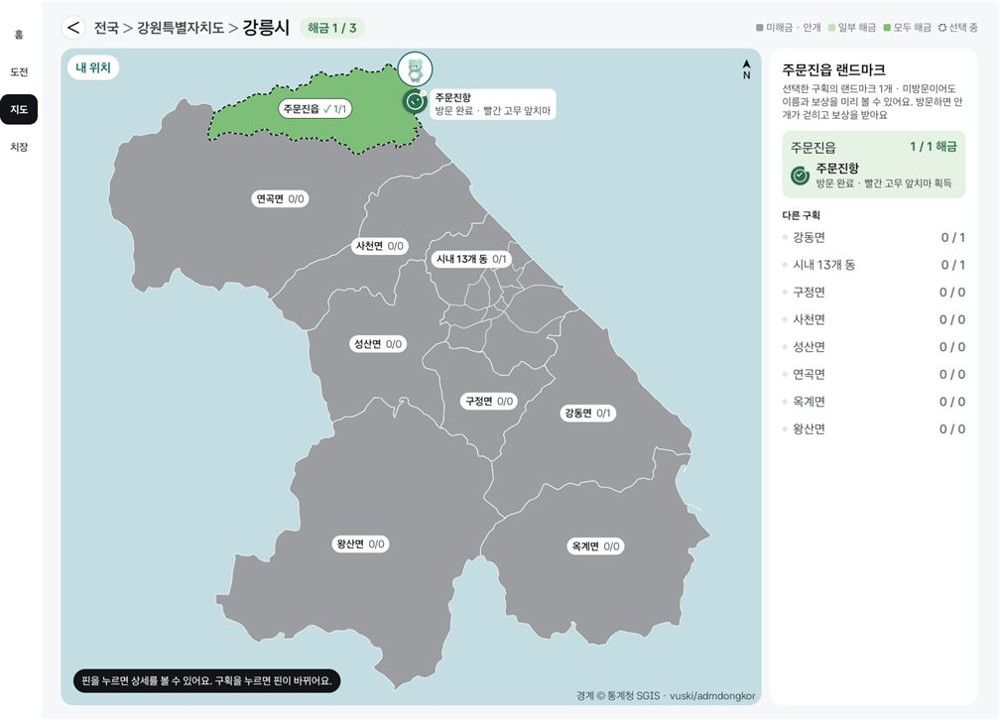
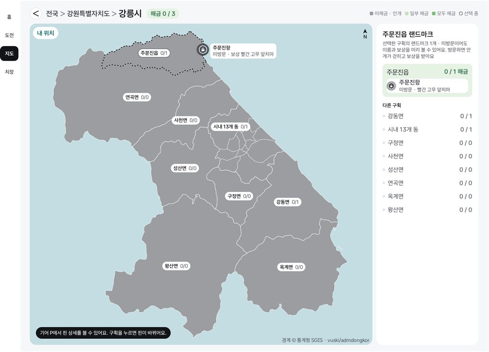
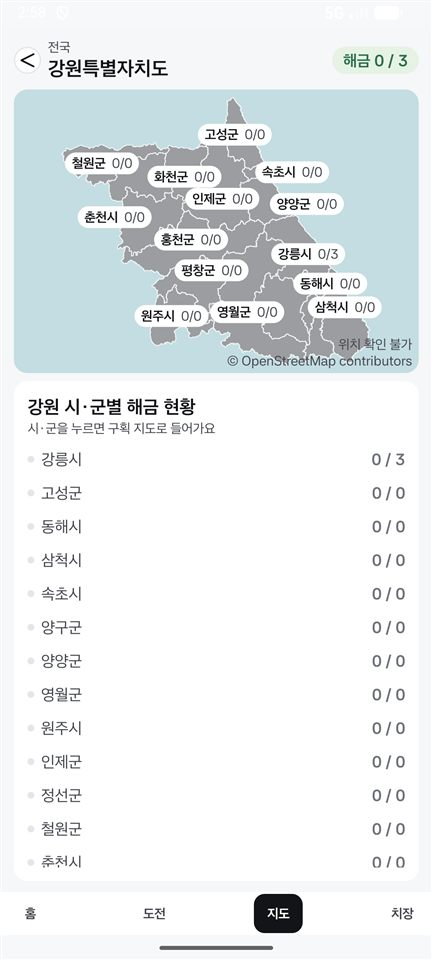
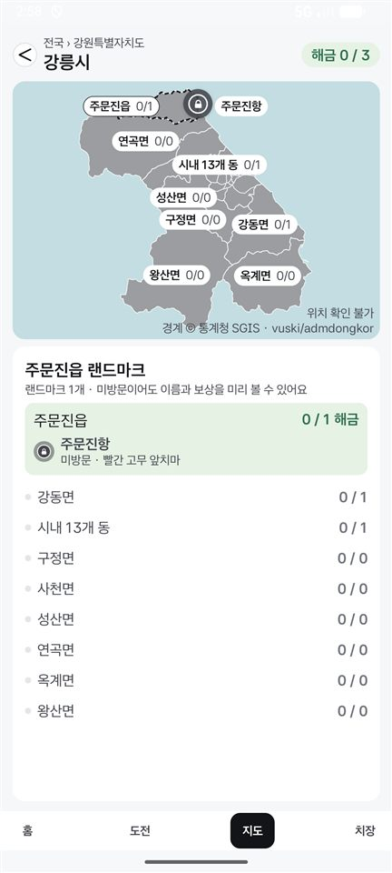
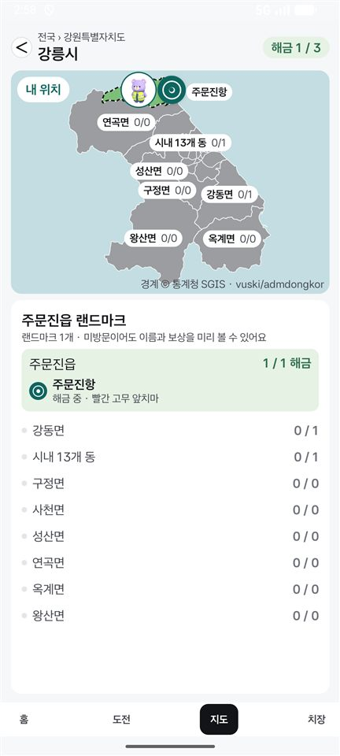
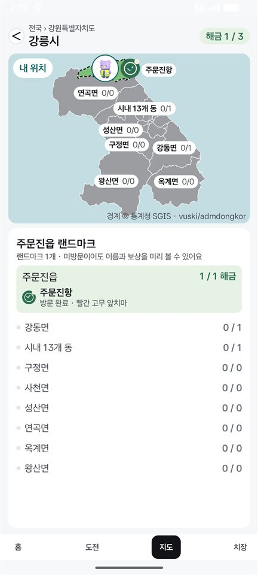
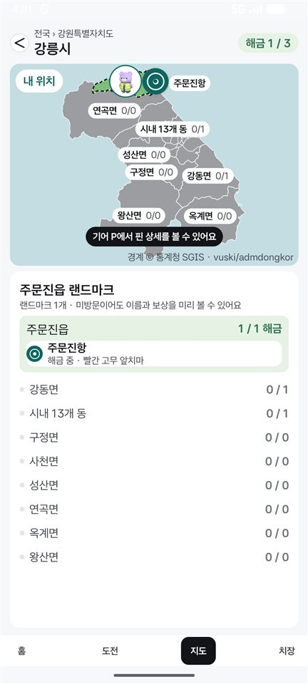

# 지도 겹침·잘림과 대기 중인 보상 표시 (2026-11-11)

이슈 #16(1~3번), #17(1·2번), #18(1번 일부·3번)을 고친 변경의 확인 기록.

- Full: Pleos Connect v2.1.0 에뮬레이터, 앱 창 1682×1210 (`full-*.jpg`, 0.6배). 에뮬레이터 기본 위치는 서울.
- Split: 폰 에뮬레이터 세로 1080×2400 (`split-*.jpg`, 0.4배). 위치를 못 받는 상태. Pleos 창을 반으로 나눈 Split(841×1210)에서는 보지 않았다.
- Mock 신호(`--es source mock`). 주행 중 방문은 `--es demo_gear D` 뒤에 `--es demo_visit LM-GN-03` (위치도 주문진항으로 옮겨진다).

## Full

| 화면 | |
|---|---|
| 전국: 카곰이 서울 이름표를 가리지 않는다 |  |
| 강릉시: 핀 이름표의 보상 이름이 다 보인다 |  |
| 주행 중 방문: 목록·이름표가 "해금 중", 카곰이 핀을 가리지 않는다 |  |
| 정차 후 보상 팝업을 닫은 뒤: "방문 완료 · … 획득" |  |
| 주행 중 핀을 눌렀을 때: 안내가 하나만 나온다 |  |
| SCR-02 안내 문구 |  |

## Split

| 강원: "위치 확인 불가"와 이름표 | 강릉시 | 주행 중 방문 | 보상 팝업을 닫은 뒤 | 주행 중 핀을 눌렀을 때 | SCR-02 |
|---|---|---|---|---|---|
|  |  |  |  |  |  |

## 본 것

- 전국·강원·강릉 지도에서 구획 이름표, 핀, 핀 이름표, 카곰, 지도 위 글이 서로 겹치지 않는다.
- 주행 중(기어 D) 방문: 지도 핀·핀 이름표·목록이 모두 해금 중으로 나오고, 기어 P에서 POP-03을 닫으면 방문 완료로 바뀐다.
- 주행 중 안내: Full은 왼쪽 아래 안내가 "기어 P에서 핀 상세를 볼 수 있어요. …"로 바뀌고 핀을 눌러도 다른 안내가 겹쳐 뜨지 않는다. Split은 지도에 안내 글이 없어 핀을 누르면 전처럼 정차 안내가 뜬다. 기어 P로 돌아오면 상세 카드가 열린다.
- 코드 리뷰 뒤 고친 것 (2026-11-11 오후, 같은 에뮬레이터에서 다시 확인): 구획 이름표가 핀 이름표도 피한다. 기어 P에서 위쪽 핀의 상세 카드가 떠 있는 동안 Full 안내 글이 숨는다 (카드가 안내 글 끝을 덮었다). Split 정차 안내가 출처 글 위에 뜬다. 카곰은 쓰던 자리가 비어 있으면 옮기지 않는다 (이것은 코드로만 넣었고 움직이는 위치로 시험하지는 못했다).
- 터치 범위: 뒤로 버튼과 경로 글자는 그림 바깥 12px 안쪽을 눌러도 동작한다 (`KagomTheme`이 누르는 범위를 64로 넓힌다). 그래서 이 둘의 크기는 바꾸지 않았다.

## 알려 둘 것

- Split에서 차가 주문진항에 있으면 "주문진읍" 구획 이름표가 숨는다 ("내 위치" 버튼과 핀 사이에 자리가 없다). 구획 이름은 아래 목록 제목에 나온다. Split 지도가 좁아 이름표가 몰리는 문제는 #16의 4번에 남아 있다.
- 이름표가 몰린 곳에서는 카곰이 위치점에서 조금 떨어진다 (전국 지도의 서울: 이름표 위).
- 목록의 "해금 중" 옆에 구획 숫자는 "1 / 1 해금", 지도 이름표는 "✓ 1/1"로 나온다. 숫자와 구획 색은 방문한 순간 바뀌는 것이 원래 동작이라 그대로 두었다.
- Split에서 주행 중 정차 안내가 아래쪽 구획 이름표를 잠깐 덮을 수 있다 (출처 글과 겹치지 않게 위로 올렸다).
- 못 본 것: 실차, Pleos Split(841×1210), 랜드마크가 여럿인 구획, 위치가 지도 가장자리에 있을 때.
