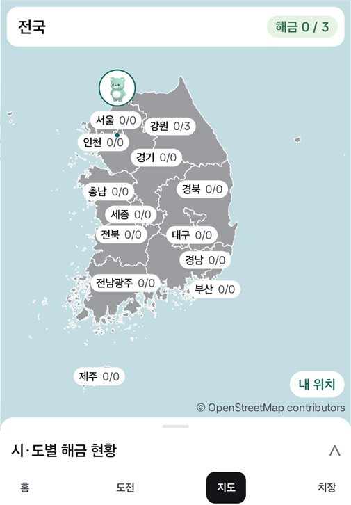
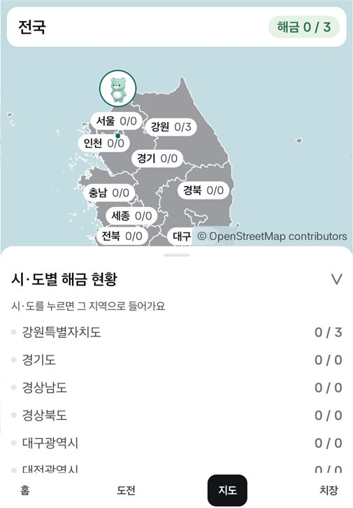
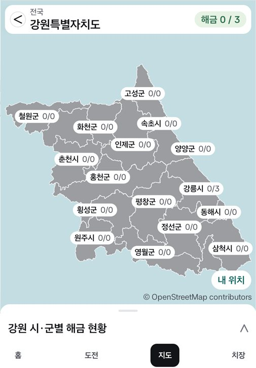
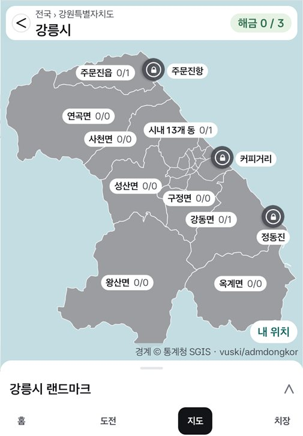
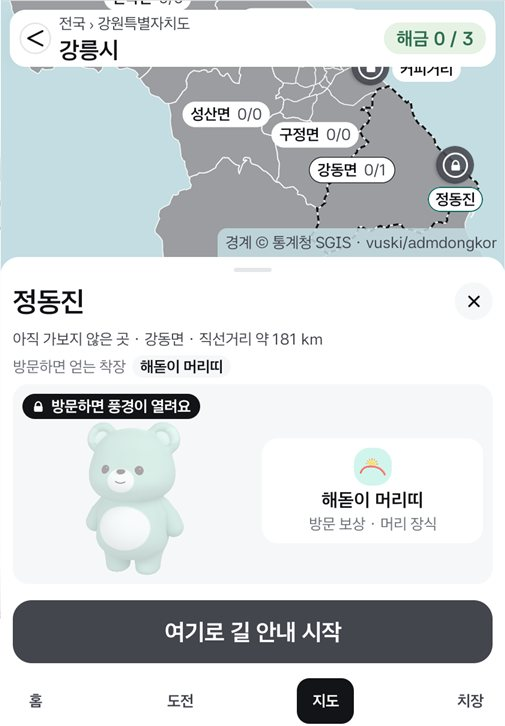
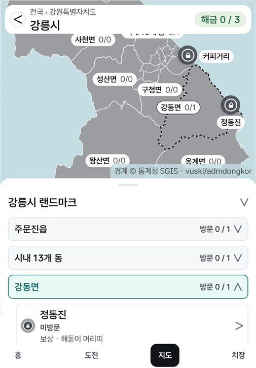
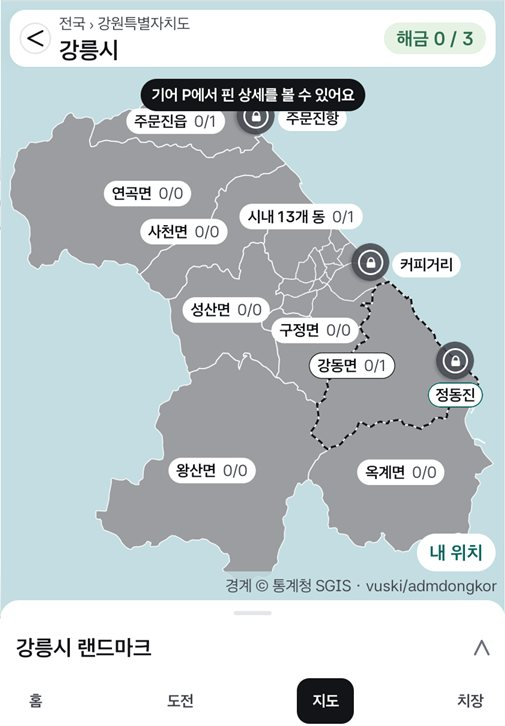
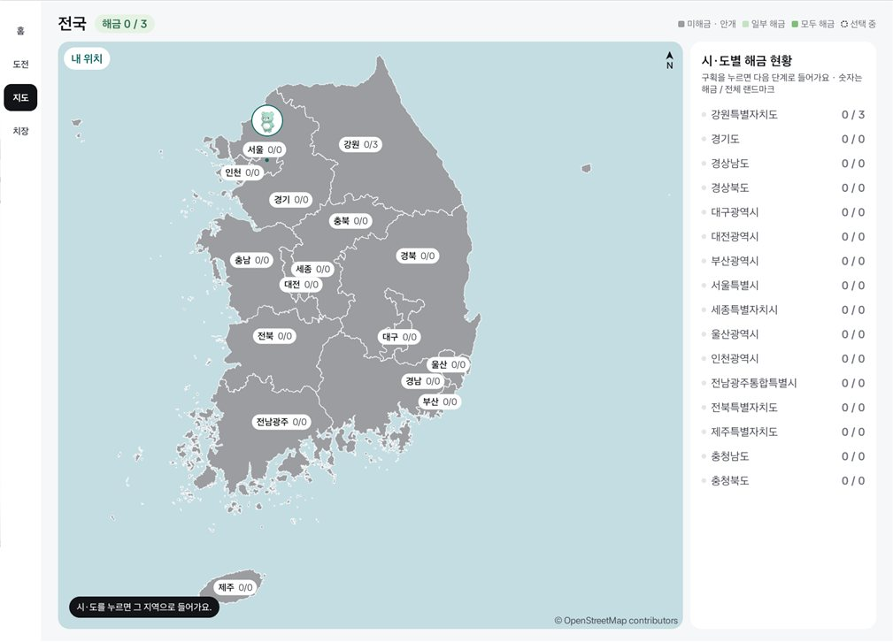
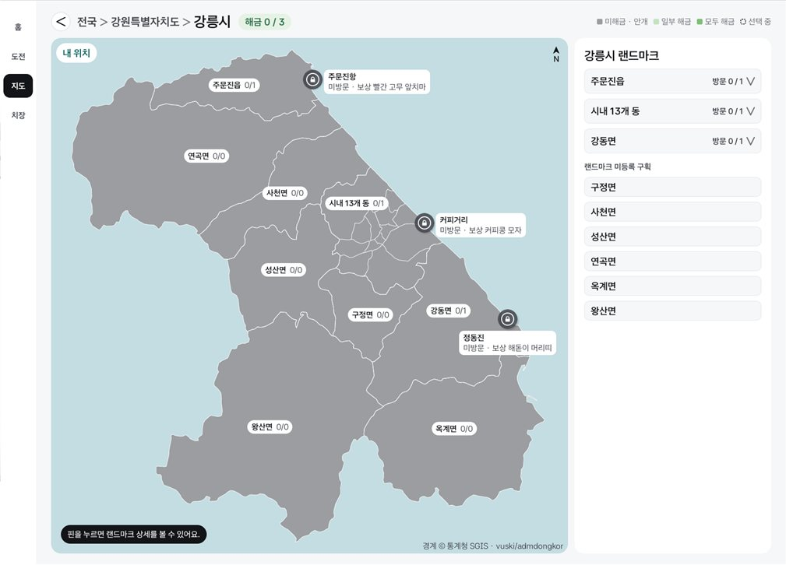
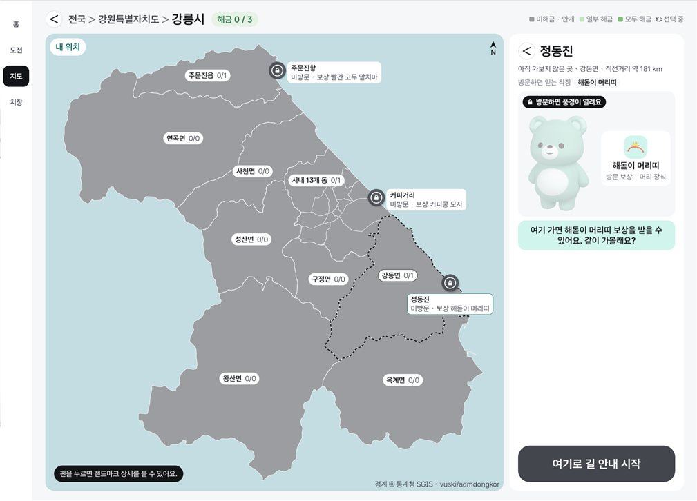

# Split 지도를 화면 전체로 (2026-11-12)

Split(Pleos 세로 슬롯, 841×1210 = 640×약 920dp)에서 지도가 화면의 40%쯤만 차지하던 것을 화면 전체로 바꾼 변경의 확인 기록.
지도 위에 머리줄을 띄우고, 목록과 랜드마크 상세는 아래에서 끌어올리는 시트로 옮겼다. Full은 바꾸지 않았다.

- Pleos Connect v2.1.0 에뮬레이터, 민트 곰(P02), 방문 기록 0, Mock 신호. 모두 0.6배로 줄였다.

## Split (Pleos 세로 슬롯)

| 전국 | 전국 + 목록 펼침 | 강원 | 강릉 |
|---|---|---|---|
|  |  |  |  |

| 핀을 눌러 상세 | ×로 닫으면 목록 | 주행 중에 핀을 누름 |
|---|---|---|
|  |  |  |

## Full (바뀌지 않음)

| 전국 | 강릉 | 강릉 + 상세 |
|---|---|---|
|  |  |  |

## 본 것

- 지도가 탭바 위 전체를 쓴다. 강릉은 구획 9개 이름표가 다 보인다 (전에는 지도 높이 약 330dp에 이름표 3개).
- 시트: 제목 줄을 누르거나 손잡이를 끌면 접힘 ↔ 목록 ↔ 상세 높이를 오간다. 목록은 시트 안에서 스크롤된다.
- 핀을 누르면 시트가 상세 높이로 올라오고, 고른 핀이 가려지지 않게 지도가 위로 밀린다. ×나 끌어내리기로 닫으면 목록(고른 구획이 펼쳐진 채)으로 돌아간다.
- 뒤로 키: 상세 닫기 → 시트 접기 → 상위 지도.
- 목록에서 시·도/시·군을 고르거나 머리줄 화살표로 단계를 옮기면 시트가 접힌다.
- 주행 중(기어 D): 핀을 눌러도 상세가 열리지 않고 "기어 P에서 핀 상세를 볼 수 있어요"만 뜬다. 다시 P로 바꾸면 고른 핀의 상세가 열린다.
- Full: 전국·강릉·상세가 전과 같다 (상세의 화살표도 그대로).

## 알려 둘 것

- 이 배치는 Figma에 없다 (Figma Split은 "지도 최대 420 + 아래 목록"). 디자인 확인이 필요하다.
- 주행 중 안내 글이 고르지 않은 핀(주문진항)을 살짝 덮을 때가 있다.
- 시트가 목록·상세 높이일 때 [내 위치] 버튼은 시트 뒤에 가려진다.
- 못 본 것: 방문 완료 랜드마크의 상세(이 프로필은 방문 기록이 없다), 치장의 [지도에서 보기]로 넘어오는 경로, 폰 세로 에뮬레이터, 실차.
