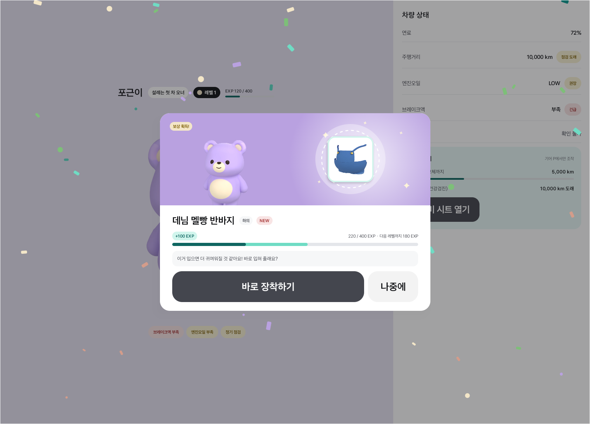
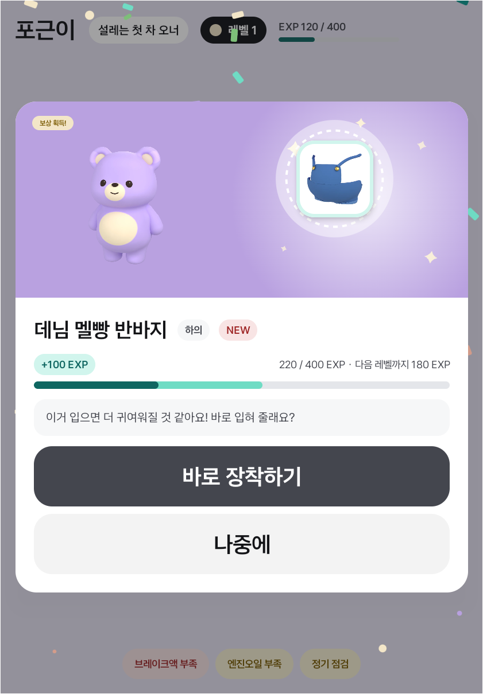
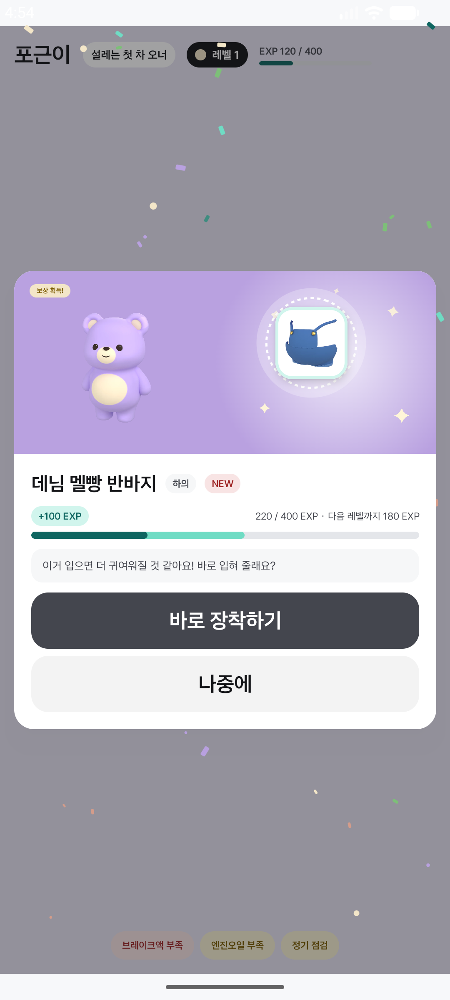

# POP-02 공개 화면 최신 디자인 반영 (2026-11-10)

원본 Kagom App에서 새로 복제한 `dknfqXLwkeJBHloP5qcQSG`의 Full `7:2514` / Split `64:3841`을 공식 Figma 디자인 컨텍스트·스크린샷으로 확인했다. 기존 사본은 사용하지 않았으며 원본 디자인은 변경하지 않았다.

## 변경

공개 본문의 “주행 보상을 받았어요!” / “첫 드라이브 달성” 두 줄을 제거했다. 모든 보상은 아이템명·카테고리·NEW → EXP → 아이템별 카곰 대사 → 장착/나중에 순서로 표시한다. 아이템 썸네일, EXP·장착 로직, 열기 전 화면은 유지했다.

Figma 카드 크기는 Full 880×638 / Split 600×650이다. 코드에서는 같은 너비·hero·여백을 유지하고 삭제된 문구만큼 자연스럽게 높이가 줄어든다. 긴 아이템명·대사 및 화면 높이가 부족한 경우 기존 줄바꿈·본문 스크롤 정책을 유지한다.

## 확인

- 최신 main `a5f4ced` 기준으로 별도 `fix/pop02-reveal-layout` 브랜치에서 빌드했다. 기존 PR #7과 팀원의 #8·#9 변경은 보존했다.
- `:app:compileDebugKotlin :app:testDebugUnitTest :app:assembleDebug` 통과. 단위 테스트 40개, 실패 0.
- 최종 APK의 폰 Split(1080×2400)에서 변경 문구, 언박싱 → 공개, D에서 숨김/P에서 복귀를 확인했다. 폰의 시스템 서비스 정지·System UI 응답 지연을 데이터 삭제 없는 콜드 부팅과 대기로 복구한 뒤 검증했다. 실제 장착 저장은 실행하지 않았다.
- 최종 APK의 Pleos Full(1682×1210) / Split(841×1210)에서 공개 문구·카드·버튼 노출을 확인했다.
- 아래 이미지는 앱 캡처다. Figma 캡처를 앱 구현 에셋으로 사용하지 않았다. 캐릭터·홈 배경 등의 기존 디자인 차이는 이번 수정에 포함하지 않았다. 실차 확인과 픽셀 단위 자동 일치 검사는 수행하지 않았다.

| Pleos Full | Pleos Split |
|---|---|
|  |  |

## 재현

```powershell
adb -s emulator-5554 shell am start --user 10 --activity-single-top -n com.example.roro/.MainActivity --es demo_popup reveal --es demo_gear P
adb -s emulator-5554 shell am start --user 10 --activity-single-top -n com.example.roro/.MainActivity --es demo_popup reward
adb -s emulator-5554 shell am start --user 10 --activity-single-top -n com.example.roro/.MainActivity --es demo_popup off
```

디버그 EX- 미리보기이며 실제 프로필·보상·정비 기록을 저장하지 않는다.


폰 Split:


