# POP-02~05 확인 (2026-11-10)

Figma MCP Bridge 0.0.25로 현재 Kagom App 원본의 초안 사본을 읽었다. Figma 파일은 수정하지 않았다.

## 재현

디버그 APK를 설치한 뒤 아래 명령의 `demo_popup` 값만 바꾼다. 카곰 최초 설정을 끝내지 않아도 프리뷰를 열 수 있다. 시연 데이터는 저장하지 않는다.

```powershell
adb -s emulator-5554 install -r app/build/outputs/apk/debug/app-debug.apk
adb -s emulator-5554 shell am start --activity-single-top -n com.example.roro/.MainActivity --es demo_popup reward --es demo_gear P
```

| 값 | 화면 |
|---|---|
| `reward` | POP-02 언박싱. 선물 열기 → 공개 |
| `reveal` | POP-02 공개, 기존 반바지 썸네일 |
| `landmark:LM-GN-01` | 정동진 · 해돋이 머리띠 |
| `landmark:LM-GN-02` | 커피거리 · 커피콩 모자 |
| `landmark:LM-GN-03` | 주문진항 · 빨간 고무 앞치마 |
| `level` | POP-04 레벨 2 · +1,000P |
| `maintenance` | POP-05 세 카드·토글·체크리스트 |
| `off` | 프리뷰 종료 |

`--es demo_gear D`에서 모달이 사라지고 P에서 돌아온다. POP-02~04 뒤로가기는 모달을 닫지 않는다. POP-05 뒤로가기·바깥 터치는 시트를 닫는다. 정비 체크리스트의 표시 문구는 바뀌지만 기존 저장 키는 유지한다.

프리뷰의 “바로 장착하기”는 실제 저장 없이 종료하고, “가까운 정비소 찾기”는 외부 지도 앱을 실행하지 않는다. 실제 기능은 기존 콜백을 사용한다. 모든 데이터 초기화 명령은 필요하지 않다.

## 기준 프레임

| 화면 | Full | Split |
|---|---|---|
| POP-02 언박싱 | 63:3228 | 64:3673 |
| POP-02 공개 | 7:2514 | 64:3841 |
| POP-03 해금 | 7:2528 | 64:3979 |
| POP-04 레벨 업 | 7:2542 | 64:4135 |
| POP-05 정비 | 7:2433 | 7:2471 |

## 확인 결과

- `:app:compileDebugKotlin`, `:app:testDebugUnitTest`, `:app:assembleDebug` 통과. 기존 단위 테스트 35개, 실패 0.
- Pleos Connect v2.1.0 API 34: Full 앱 영역 1682×1210, Split 앱 영역 841×1210에서 네 팝업 및 세 랜드마크를 확인했다. Split 정비 시트를 스크롤해 마지막 점검 버튼에 도달했다.
- Medium Phone API 37.0 (1080×2400): 모든 프리뷰, 선물 열기→공개, 모달 뒤로가기 차단, 정비 뒤로가기 닫기, D에서 숨김/P에서 공개 복귀를 확인했다.
- 실제 저장소·실제 콜백 경로에서도 정비 시트가 열린 동안 QST-01이 큐에 대기하고, 시트를 닫은 뒤 언박싱이 나오는 것을 확인했다. 열기 후 D/P 전환에도 공개 단계가 유지되고, 장착을 누르면 `equipped.bottom=ITM-B-01`로 저장되며 큐가 비워졌다. [검사 결과](production-checks.json). 테스트 이전 설정은 복원했다.
- 프리뷰는 외부 지도 앱이나 실제 포인트 API를 검증하지 않는다. 실제 차량에서는 확인하지 않았다. 기본 화면·캐릭터 모델의 기존 디자인 차이는 이 변경 범위에 포함하지 않는다. 픽셀 단위 자동 일치 검사는 수행하지 않았다.

| Pleos Full | 세로 폰 Split |
|---|---|
| 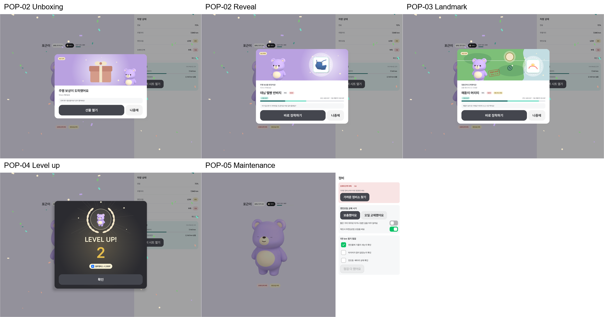 | 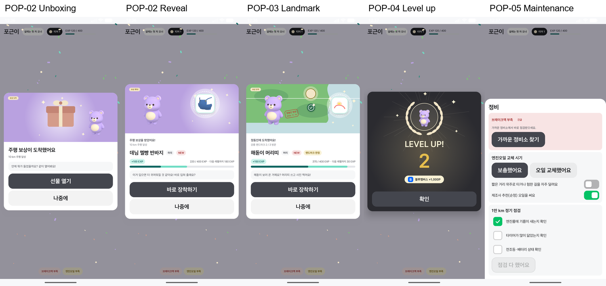 |

실제 Pleos 1/3 창:

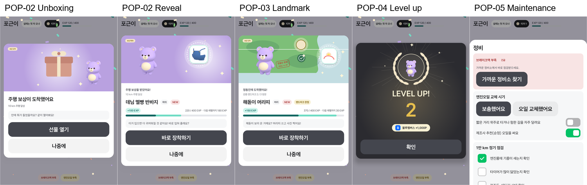

좁은 정비 시트의 스크롤 후 마지막 버튼:

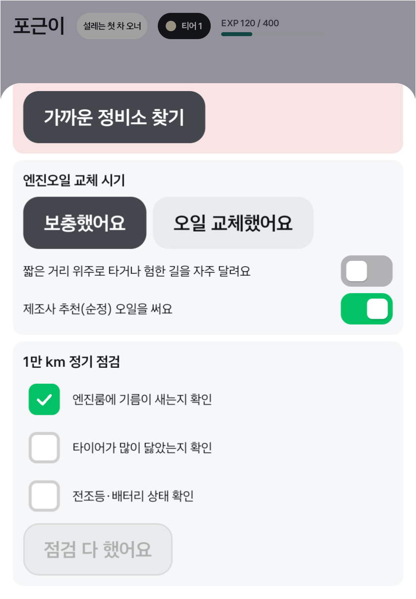

Pleos 선물 열기→공개 동작 녹화:

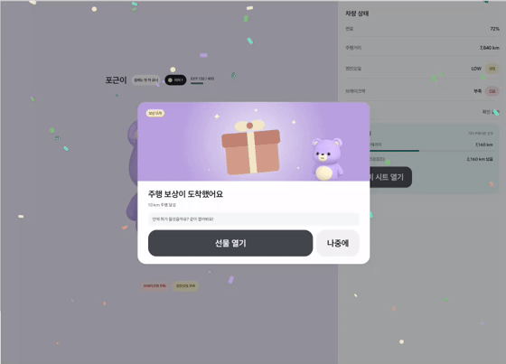


## 정기 점검 후속 수정 (2026-11-10)

- 최종 빌드 `:app:compileDebugKotlin :app:testDebugUnitTest :app:assembleDebug` 통과, 단위 테스트 38개/실패 0.
- 실제 컨트롤러·저장소 경로에서 EV 9,999 km 완료 불가 → 10,000 km 세 항목 체크·완료 → 1회차 저장·완료 버튼 사라짐 → 19,999 km 완료 불가 → 20,000 km 2회차 체크·완료를 확인했다. D에서는 정비 시트가 숨겨지고 기록이 바뀌지 않았다. [검사 결과](maintenance-distance-checks.json). 테스트 전 폰 SharedPreferences 원본을 바이트 단위로 복구했다.
- Pleos Full(1682×1210)·Split(841×1210)에서는 EX- 미리보기로 EV 항목과 완료 후 남은 거리 표시를 확인했다. 폰 Split에서는 실제 콜백으로 검증했다. 실차 주행·SDK 실시간 거리 증가 검증은 하지 않았으며 기존 Pleos odometer 구독을 사용한다.
- 재현: 디버그 패널의 팝업 미리보기에서 **전기차 점검** / **점검 완료**를 선택하거나 아래 명령을 사용한다. 미리보기는 저장하지 않는다.

```powershell
adb -s emulator-5554 shell am start --user 10 --activity-single-top -n com.example.roro/.MainActivity --es demo_popup maintenance-ev --es demo_gear P
adb -s emulator-5554 shell am start --user 10 --activity-single-top -n com.example.roro/.MainActivity --es demo_popup maintenance-done
adb -s emulator-5554 shell am start --user 10 --activity-single-top -n com.example.roro/.MainActivity --es demo_popup off
```

| 상태 | Pleos Full | Pleos Split | 폰 Split (실제 콜백) |
|---|---|---|---|
| 전기차 점검 | 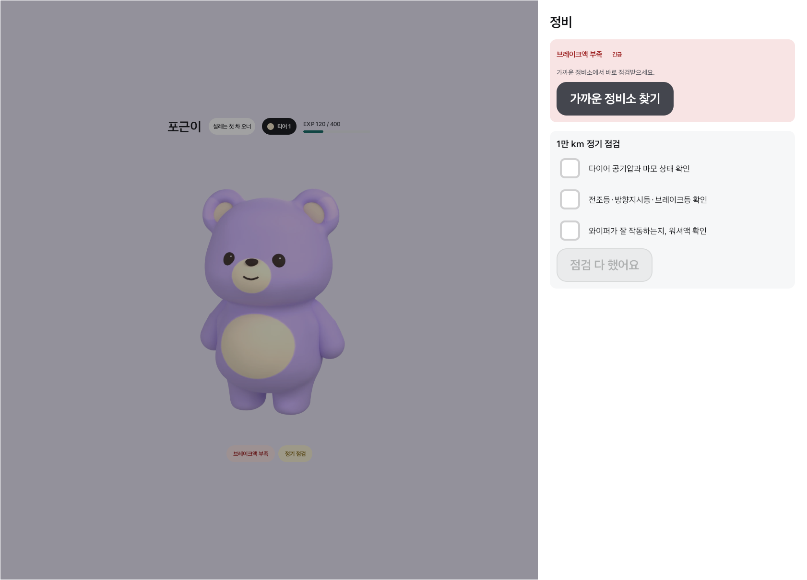 | 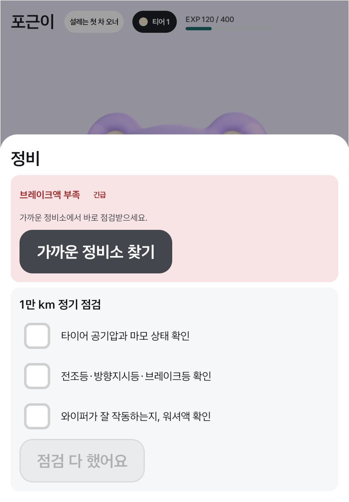 | 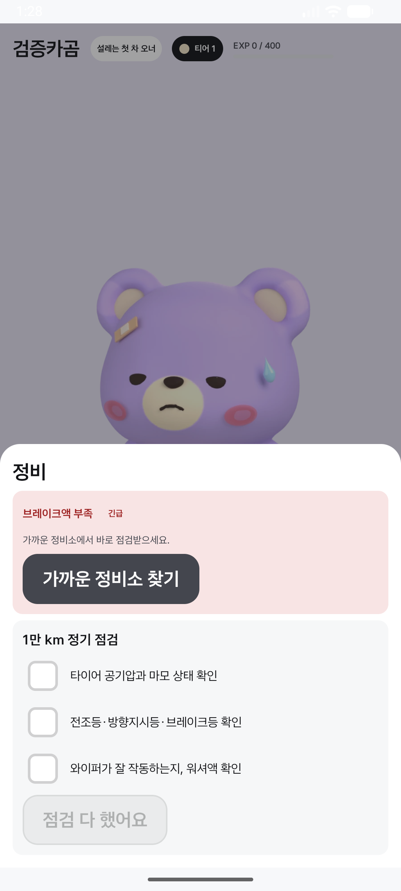 |
| 완료 후 대기 | 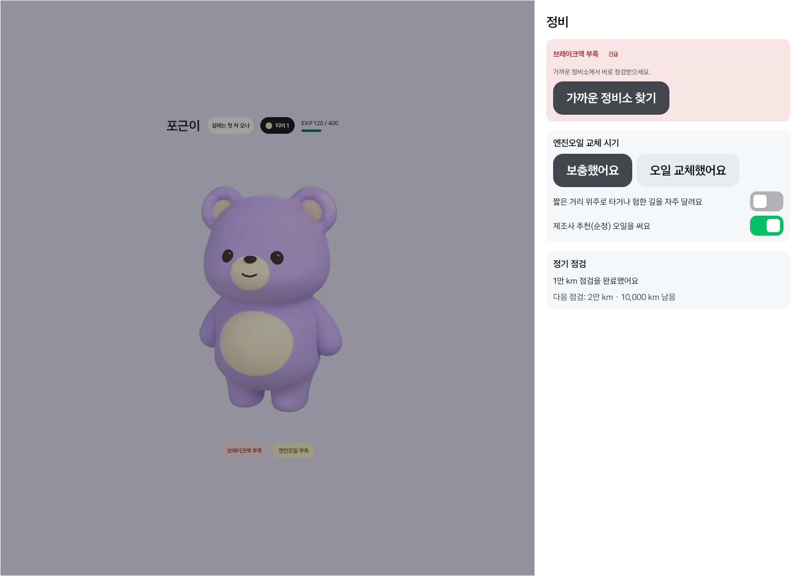 | 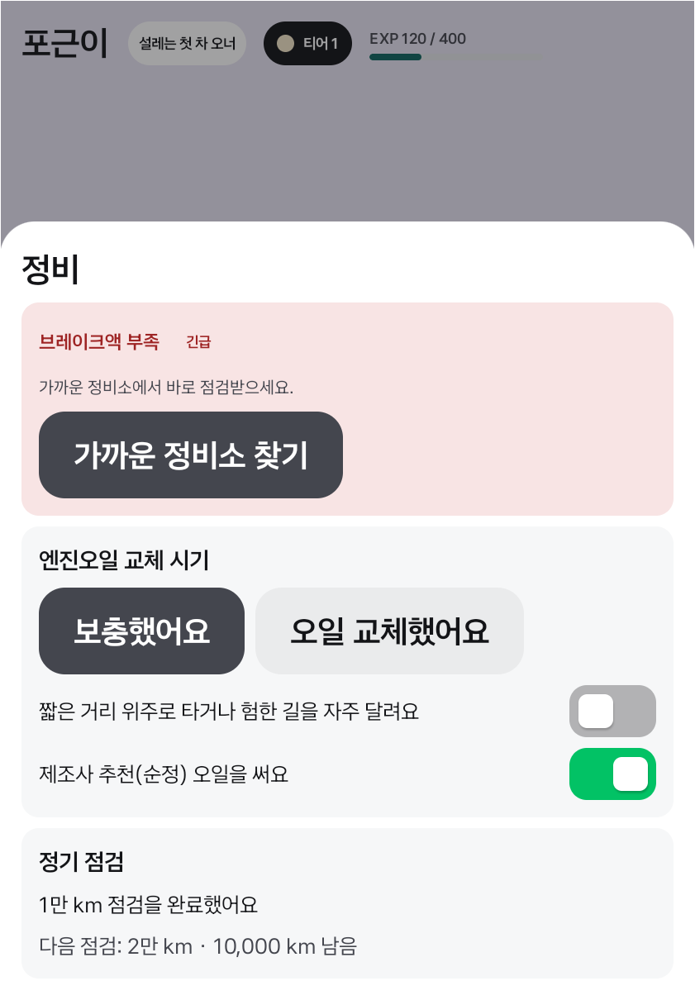 | 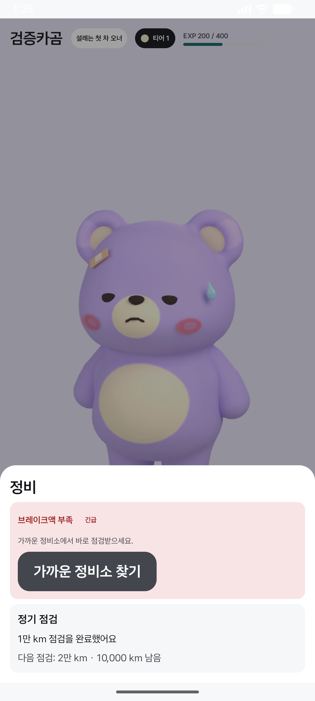 |

기존 설치에 이미 저장된 완료 회차는 임의로 되돌리지 않는다. 실제 점검 기록과 예전 시연으로 생성한 기록을 구별할 수 없기 때문이다.
