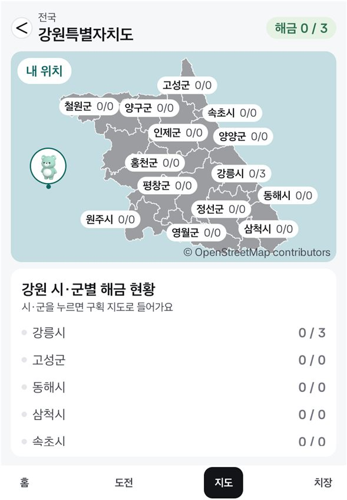
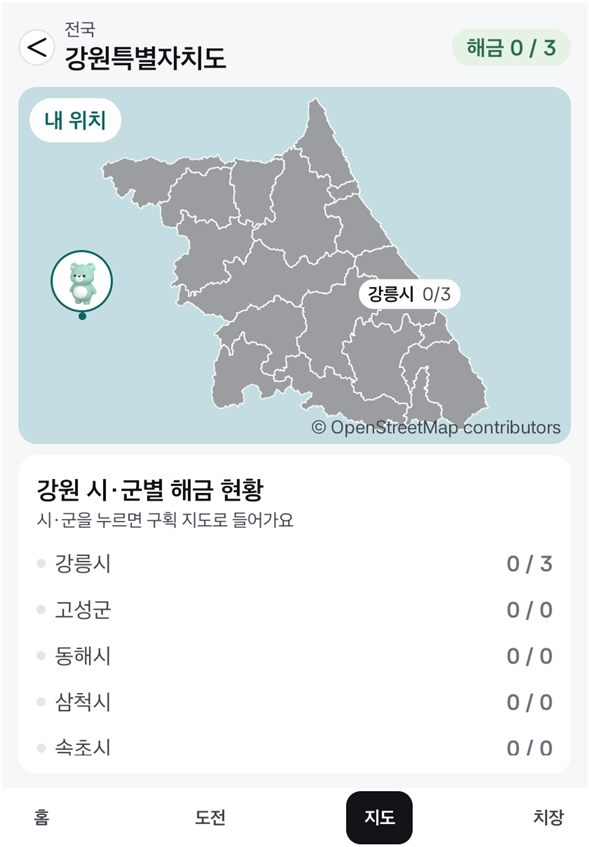
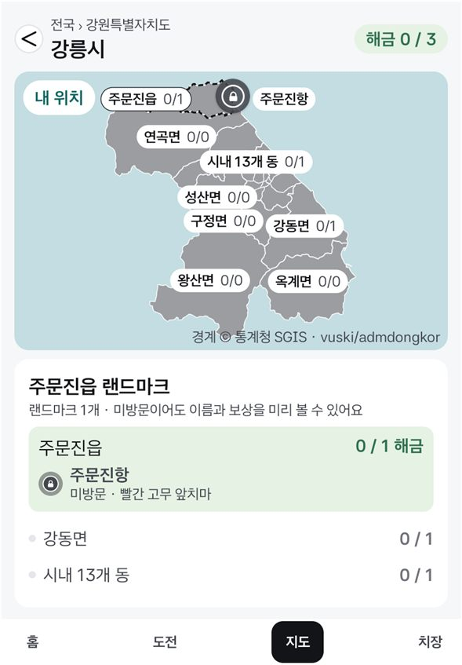
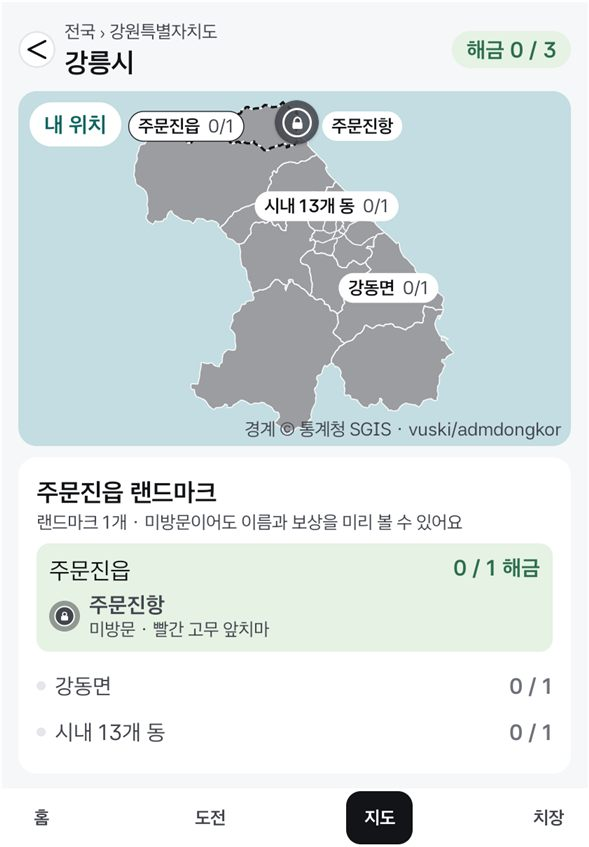
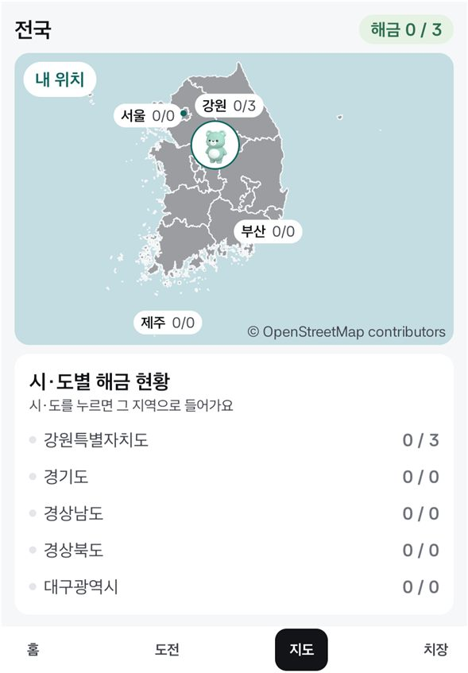
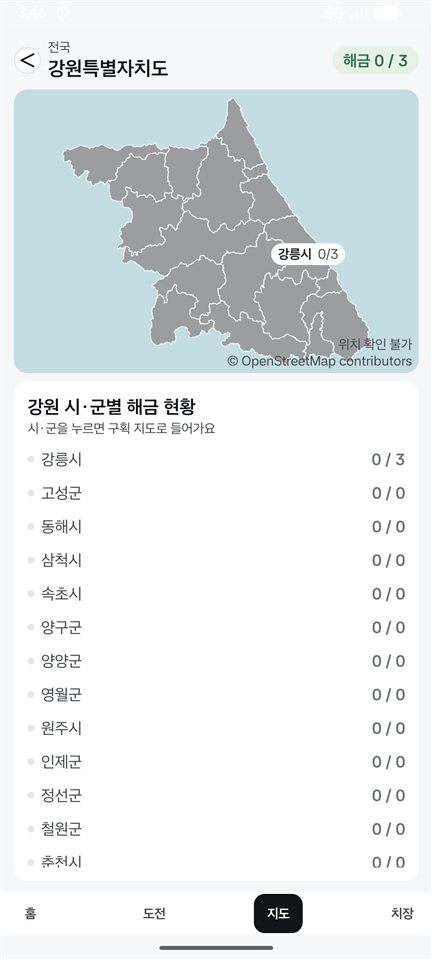
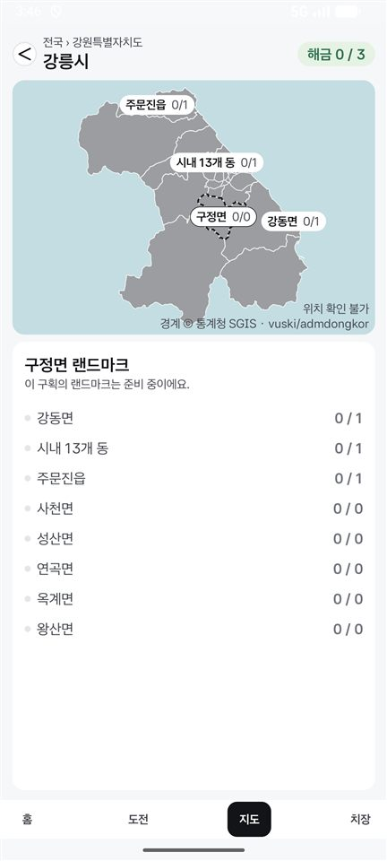

# Split 지도 이름표 추리기 (2026-11-11)

이슈 #16 4번(Split 지도에서 이름표가 구획을 대부분 덮음)을 고친 변경의 확인 기록. Figma에 없는 규칙이라 가정으로 정했다 (`docs/IMPLEMENTATION.md` 지도 절).

- Pleos 세로 슬롯: Pleos Connect v2.1.0 에뮬레이터, 앱 창 841×1210 (`slot-*.jpg`, 0.7배). 실제 차의 Split과 같은 크기다.
- 폰: 폰 에뮬레이터 세로 1080×2400 (`split-*.jpg`, 0.4배).

## Pleos 세로 슬롯을 여는 방법

Pleos 에뮬레이터에서 앱 창 오른쪽 가장자리의 손잡이(⋮)를 왼쪽으로 끌면 앱이 세로 슬롯으로 줄고 오른쪽에 내비게이션이 뜬다.

```
adb -s emulator-5554 shell input swipe 2547 720 1700 720 600
```

앱을 다시 켜면 Full로 돌아가므로 그때마다 다시 끈다.

## 전 / 후 (Pleos 세로 슬롯)

| | 전 (#21까지) | 후 |
|---|---|---|
| 강원 |  |  |
| 강릉시 |  |  |

전국은 바뀌지 않는다: 

## 폰 에뮬레이터

| 강원 | 강릉시에서 목록의 구정면을 고름 |
|---|---|
|  |  |

## 본 것

- 강원: 랜드마크가 있는 강릉시에만 이름표가 붙고 시·군 경계가 다 보인다.
- 강릉시: 주문진읍·시내 13개 동·강동면에만 이름표가 붙는다. 목록에서 랜드마크가 없는 구정면을 고르면 그 구획에 점선 테두리와 이름표가 붙는다.
- 강릉시 지도에서 랜드마크가 없는 왕산면을 누르면 그 구획에 점선 테두리와 이름표가 붙는다.
- Full(가로)은 바뀌지 않는다: 강원 지도에 시·군 이름표가 전부 나온다.

## 알려 둘 것

- 이름표가 없는 구획은 지도만 봐서는 이름을 알 수 없다. 이름은 아래 목록에 있고, 지도에서 구획을 눌러도 이름표가 붙는다 (구획 지도) 또는 그 지도로 들어간다 (시·군 지도).
- 랜드마크가 많아지면 이름표도 다시 늘어난다. 그때는 겹치는 이름표를 숨기는 기존 규칙이 적용된다.
- 못 본 것: 실차, 주행 중 상태(조건에 기어가 들어가지 않는다).
