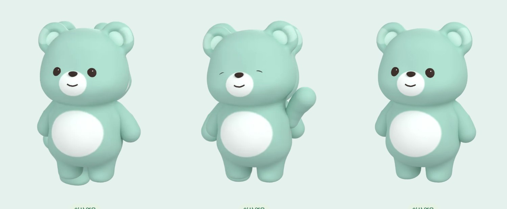
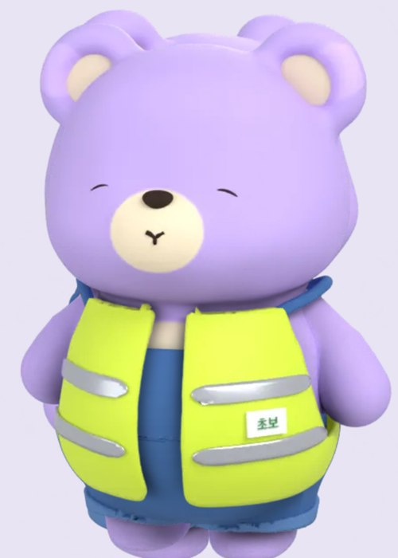
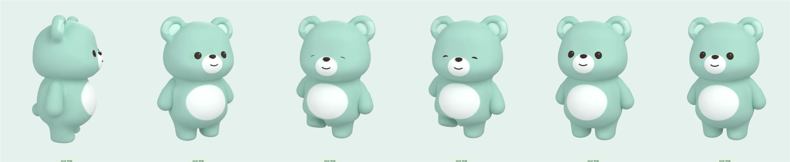
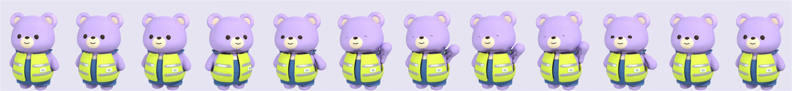

# 돌려 둔 캐릭터를 눌렀을 때의 잔상 (2026-11-10)

홈에서 캐릭터를 밀어 돌린 뒤, 제자리로 돌아오기 전에 누르면 다른 각도의 돌려보기 그림 위에 정면 동작 프레임이 겹쳐 그려졌다.

## 고치기 전

Pleos Full (main `2294a84`). 밀기 → 바로 탭 → 연속 캡처. 앞의 두 장에서 정면 곰 뒤로 다른 각도의 귀·팔·발이 비친다.



폰 Split (main 기준 빌드). 귀가 둘로 보인다.



## 고친 뒤

Pleos Full. 왼쪽부터 돌려 둔 상태(탭 직전) → 정면으로 돌아옴 → 발 동동 동작 두 장 → 대기. 겹친 그림이 없다.



폰 Split (화면 녹화에서 같은 간격으로 뽑은 12장). 돌림 → 정면 복귀 → 손 흔들기 → 대기.



## 확인한 것

- Full·Split: 밀어 돌린 직후(관성 회전 포함) 탭 → 정면으로 돌아온 뒤 동작이 재생되고 겹침이 없다.
- Full: 탭하고 0.04초 뒤 `demo_gear D` → 0.65초 안에 찍은 캡처에서 이미 대기 자세다 (가장 짧은 동작이 0.9초). 기어 D에서는 탭·밀기에 반응하지 않는다. P로 돌아오면 다시 된다.
- `:app:compileDebugKotlin :app:testDebugUnitTest :app:assembleDebug` 통과 (단위 테스트 40개, 실패 0).

## 재현

```
adb shell input swipe 1350 723 1600 723 450    # Pleos Full 홈의 캐릭터 위에서 밀기
adb shell input tap 1453 723                    # 손을 뗀 직후 탭
```

못 한 것: 실차 확인. Pleos 에뮬레이터의 Split 창에서는 보지 않았다 (Split은 폰 에뮬레이터 1080×2400).
