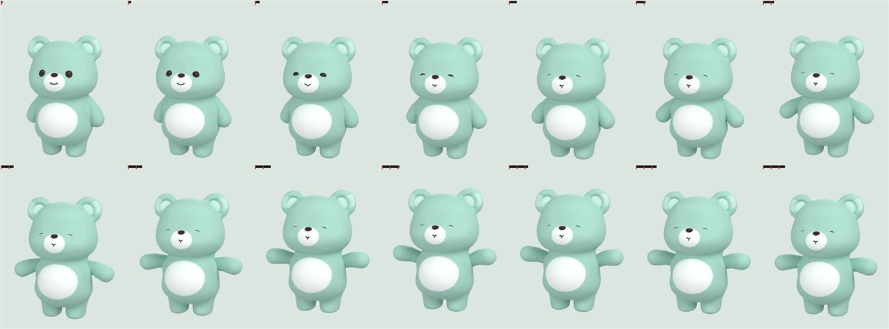
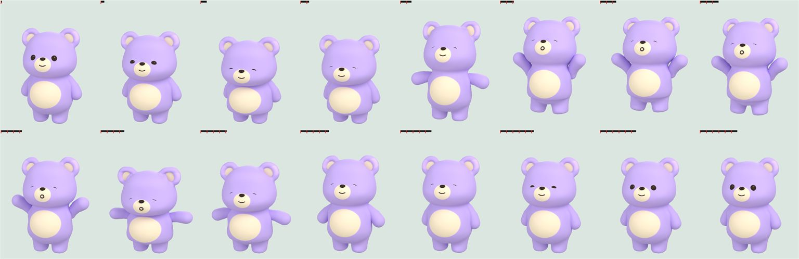
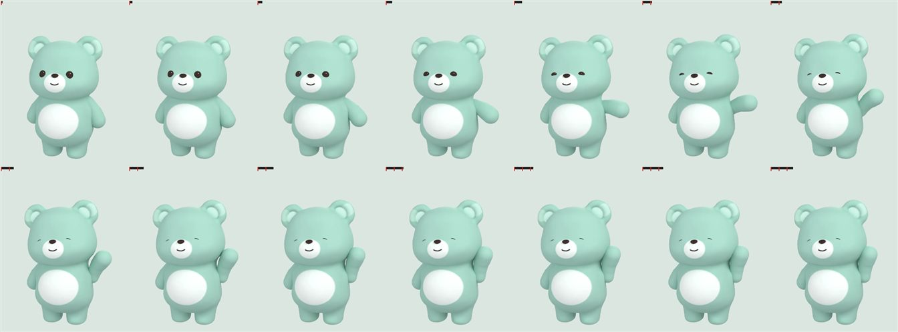
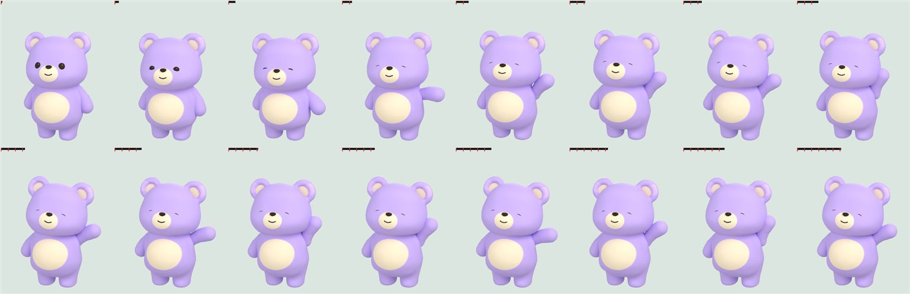
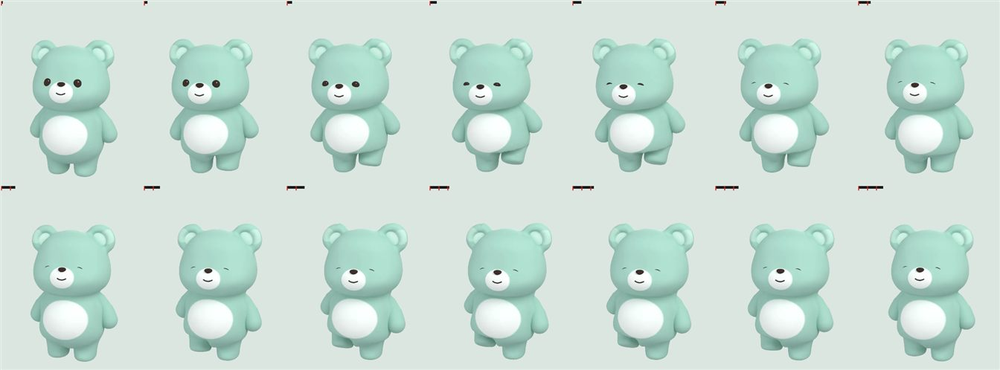
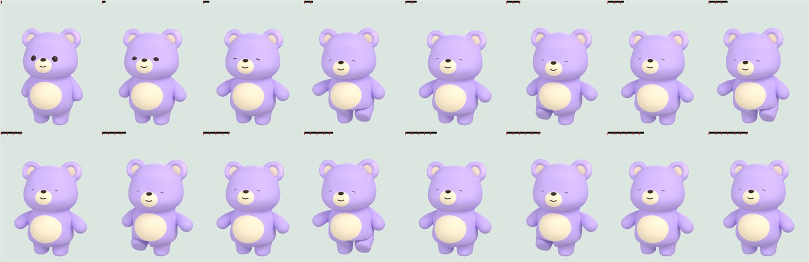
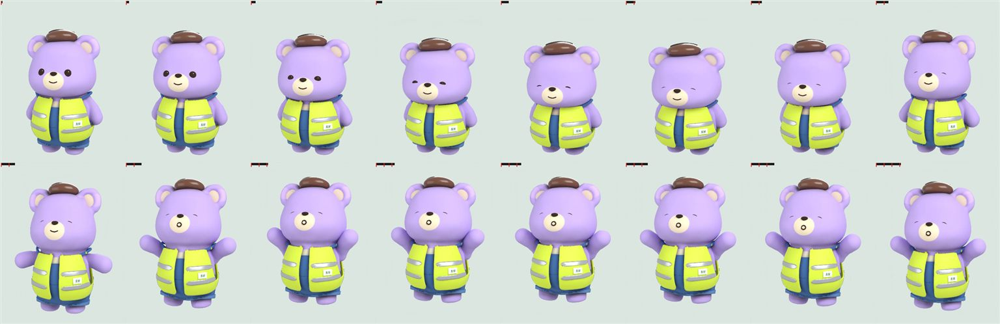
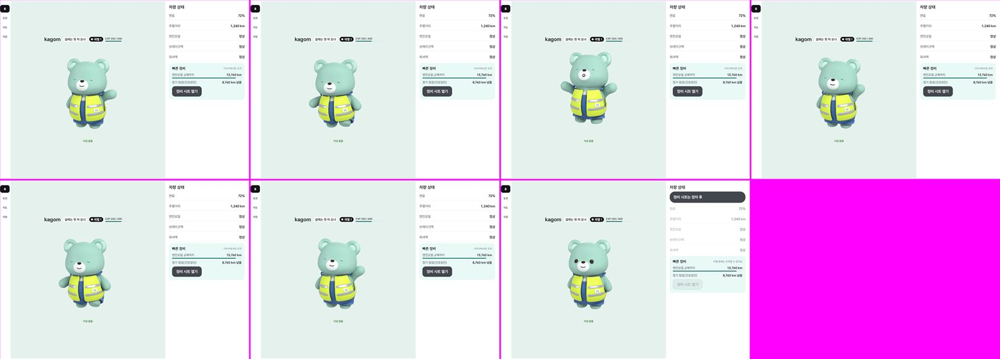
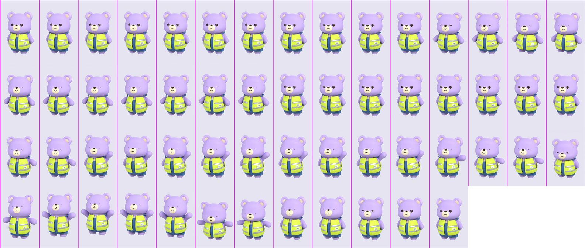
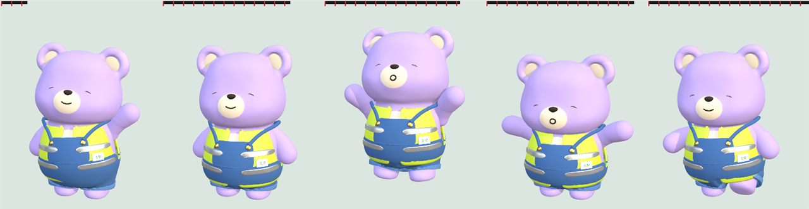

# 터치 반응 동작을 자연스럽게 (2026-11-11)

캐릭터를 눌렀을 때의 3D 동작 세 개(손 흔들기·만세·발 동동)를 다시 만든 변경의 확인 기록. 동작 정의는 `tools/closet3d/build_closet.py`의 `pose_wave`·`pose_cheer`·`pose_stomp`.

- 프레임 표: 왼쪽 위부터 차례로, 전은 한 프레임씩(스킨 P02), 후는 두 프레임에 한 장(스킨 P03, 옷 없음).
- 앱: Pleos Connect v2.1.0 에뮬레이터(Full, 앱 창 1682×1210)와 폰 에뮬레이터 세로(Split, 1080×2400). Mock 신호.

## 전 / 후

| | 전 | 후 |
|---|---|---|
| 만세 |  |  |
| 손 흔들기 |  |  |
| 발 동동 |  |  |

- 만세: 팔을 옆으로 벌린 T자 → 움츠렸다가 뛰어오르며 팔을 비스듬히 위로, 내려앉으며 몸이 눌렸다 돌아온다 (22 → 30프레임).
- 손 흔들기: 팔만 차단기처럼 올라감 → 팔을 앞으로 돌려 올리고 몸은 반대쪽으로 기대며 고개를 갸웃 (38 → 42프레임).
- 발 동동: 든 다리가 몸 안으로 파묻힘, 네 걸음이 똑같음 → 천천히 들었다 탁 내리기를 여섯 번, 닿을 때마다 몸이 살짝 내려앉는다 (28 → 36프레임).

옷을 겹친 모습 (앱과 같은 방식: 몸 + 하의·상의·머리 레이어): 

## 앱에서

| Full (눌렀을 때 여섯 번 + 마지막은 주행 중) | Split (화면 녹화의 모든 프레임, 초당 5장) |
|---|---|
|  |  |

## 본 것

- Full·Split에서 세 동작이 모두 재생되고, 시작과 끝이 기본 자세 그림과 어긋나지 않는다. 옷(조끼·멜빵 반바지)이 몸을 따라 움직인다.
- 주행 중(기어 D)에는 눌러도 움직이지 않는다 (동작은 바꾸지 않았다).
- 열어 둔 Blender(MCP 애드온)에 `--what live`로 올려 카메라 시점에서 동작을 확인했다: 

## 알려 둘 것

- 에뮬레이터 화면 녹화는 초당 5장이라 움직임의 속도감(24 fps)은 사람 눈으로 확인하지 못했다. 프레임 표와 Blender 타임라인으로 봤다.
- 팔은 뼈가 하나라 팔꿈치가 없다. 팔을 굽히는 동작은 모델(glb)을 고쳐야 한다.
- 동작 프레임 용량: `assets/kagom/motion` 26 MB → 33 MB (프레임 수 88 → 108).
- 못 본 것: 실차, Pleos Split(841×1210), 스킨 8종 전부(P02·P03만 펼쳐 봤다), 옷 6종 전부(조끼·멜빵 반바지·커피콩 모자만).
