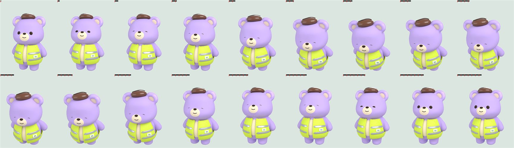
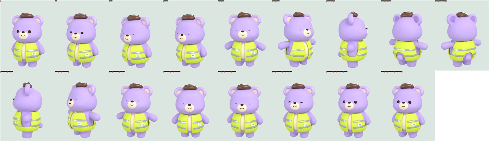
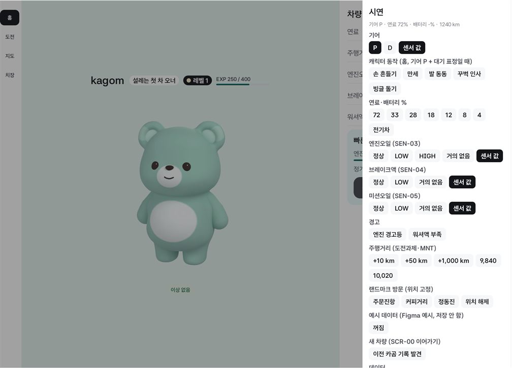
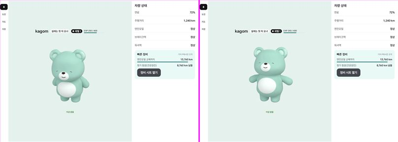
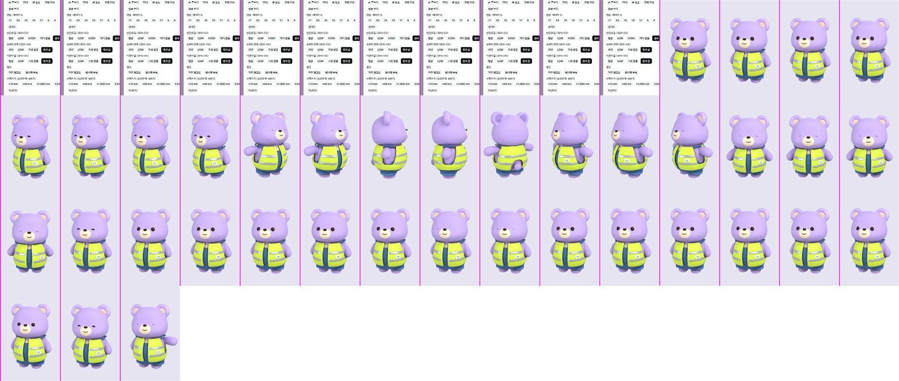

# 터치 반응 동작 두 개 추가 + 시연에서 골라 보기 (2026-11-11)

- 새 동작: 꾸벅 인사(`bow`, 34프레임), 빙글 돌기(`spin`, 32프레임). 정의는 `tools/closet3d/build_closet.py`의 `pose_bow`·`pose_spin`.
- 시연 패널 "캐릭터 동작"에서 다섯 동작 중 하나를 고르면 홈으로 가서 한 번 튼다. adb로는 `--es demo_act wave|cheer|stomp|bow|spin`.
- Full: Pleos Connect v2.1.0 에뮬레이터 (앱 창 1682×1210). Split: 폰 에뮬레이터 세로 1080×2400. Mock 신호.

## 새 동작 (두 프레임에 한 장, 조끼·커피콩 모자 착용)

| 꾸벅 인사 | 빙글 돌기 |
|---|---|
|  |  |

## 시연 패널

| Full: 패널 | Full: 패널에서 꾸벅 인사·빙글 돌기를 고른 직후 |
|---|---|
|  |  |

Split: 패널에서 빙글 돌기를 고르고, 이어서 `demo_act wave`를 보낸 화면 녹화 (모든 프레임, 초당 약 6장)

## 본 것

- Full·Split에서 시연 패널을 열어 꾸벅 인사와 빙글 돌기를 골라 재생했다. 패널이 닫히고 홈에서 고른 동작이 한 번 재생된다.
- Split에서 `--es demo_act wave`로 손 흔들기가 재생된다.
- 빙글 돌기는 옷(조끼·멜빵 반바지)과 모자가 몸을 따라 돈다.

## 알려 둘 것

- 시연에서 고른 동작도 터치 반응과 같은 조건(기어 P + 대기 표정)에서만 재생된다. 조건이 안 맞으면 조건이 맞을 때까지 기다렸다가 재생된다 (주행 중에 고르고 기어를 P로 바꾸면 그때 재생).
- 캐릭터를 직접 누르면 다섯 동작 중 바로 전과 다른 것이 무작위로 나온다. 새 두 동작이 무작위로 나오는 것은 따로 확인하지 않았다.
- 속도감(24 fps)은 에뮬레이터 녹화가 느려 사람 눈으로 확인하지 못했다.
- 동작 프레임 용량: `assets/kagom/motion` 33 MB → 51 MB (1,512장 → 2,436장).
- 못 본 것: 실차, Pleos Split(841×1210), 스킨·옷 전부, 탭이 홈이 아닐 때 패널에서 골랐을 때 홈으로 넘어가는 것.
